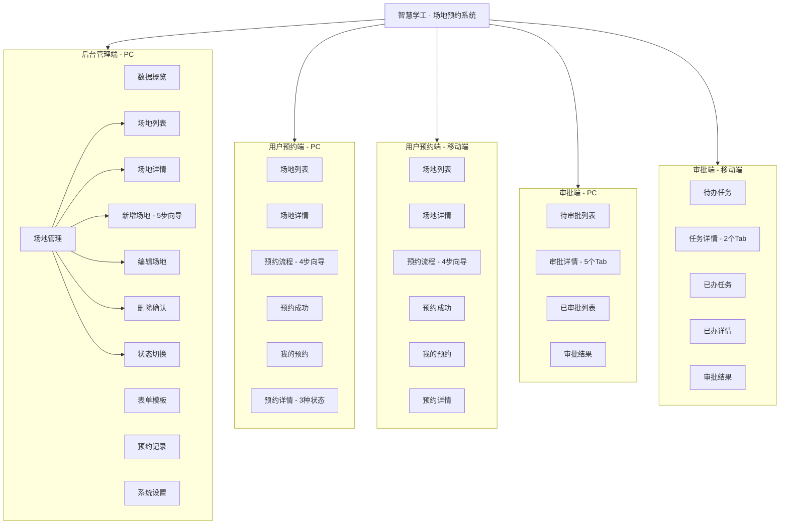
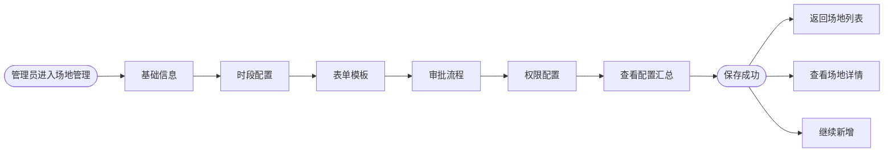
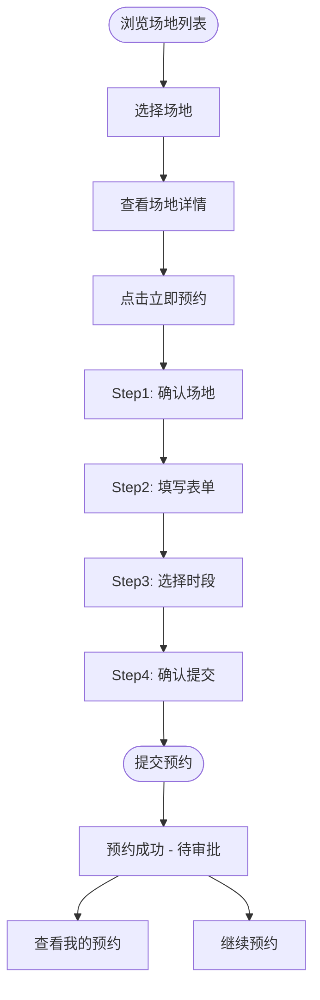
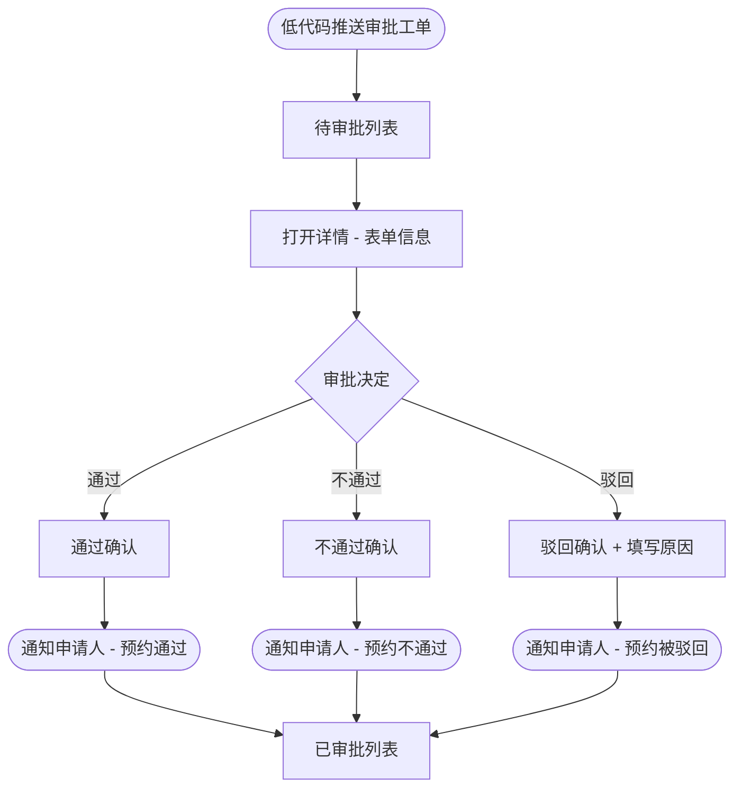
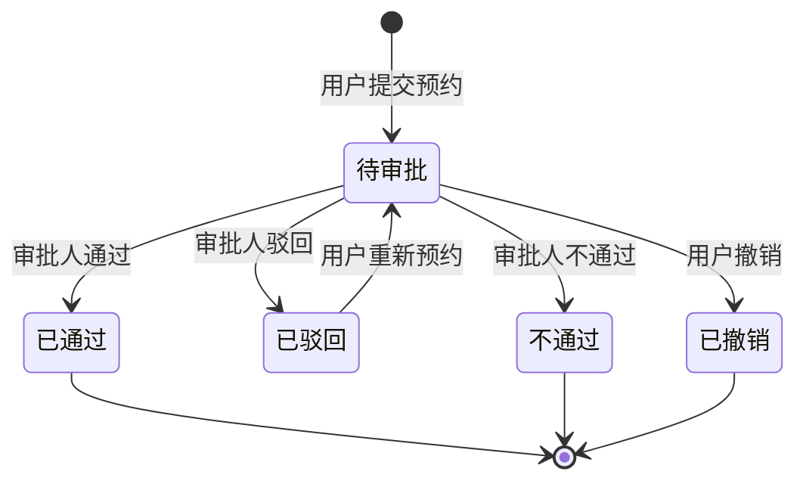

# 智慧学工 · 场地预约系统 产品需求文档（PRD）

> **版本**：v1.0  
> **产品负责人**：学生工作部  
> **适用范围**：中南大学智慧学工平台 — 场地预约子系统  
> **文档日期**：2026 年 4 月  
> **原型版本**：HTML 静态原型 v1.0（共 97 页，含 30 个场地完整配置）

---

## 目录

1. [产品概述](#1-产品概述)
2. [用户角色与权限](#2-用户角色与权限)
3. [功能模块详述](#3-功能模块详述)
4. [信息架构](#4-信息架构)
5. [核心业务流程](#5-核心业务流程)
6. [数据模型](#6-数据模型)
7. [配置化设计](#7-配置化设计)
8. [非功能需求](#8-非功能需求)
9. [原型页面索引](#9-原型页面索引)

---

## 1. 产品概述

### 1.1 产品背景

中南大学学生工作部下辖多个科室（综合办、民族办、思政办、就业指导中心、心理中心、学生事务办、武装部），共管理 30 个不同类型、不同用途的场地资源。现有场地预约依赖线下登记或分散的在线表单，存在以下痛点：

- 场地信息分散，师生查询困难
- 预约流程不统一，各科室各自管理
- 审批环节依赖人工通知，效率低下
- 缺乏统一的数据统计与分析

### 1.2 产品目标

构建统一的场地预约管理平台，实现：

1. **场地资源集中管理**：30 个场地的基础信息、开放规则、时段策略统一配置
2. **标准化预约流程**：师生通过 PC 或移动端发起预约，填写场地对应的表单模板
3. **低代码审批集成**：对接低代码平台工作流引擎，实现可配置的多级审批
4. **数据可视化运营**：提供预约趋势、场地热度、审批效率等运营指标

### 1.3 核心价值主张

| 维度 | 说明 |
|------|------|
| 配置化场地管理 | 每个场地可独立配置时段策略（7 种）、表单模板（13 套）、审批流程（多级+分支）、发起权限 |
| 低代码审批引擎 | 审批流程通过低代码平台推送，审批端采用统一的工单列表+表单详情模式 |
| 多端适配 | 管理后台（PC）、用户预约端（PC+移动端）、审批端（PC+移动端） |
| 数据驱动 | 仪表盘覆盖 8 项核心指标，支持趋势、排行、分布多维分析 |

### 1.4 产品范围边界

| 范围内 | 范围外 |
|--------|--------|
| 场地信息 CRUD 与配置 | 场地硬件设备物联网管控 |
| 用户在线预约与表单填写 | 在线支付/费用结算 |
| 低代码审批工作流 | 自定义审批引擎开发 |
| 预约数据统计与导出 | BI 报表定制开发 |
| PC + 移动端 H5 | 原生 App（iOS/Android） |

---

## 2. 用户角色与权限

### 2.1 角色定义

| 角色 | 描述 | 使用终端 |
|------|------|----------|
| **系统管理员** | 学工部各科室管理人员，负责场地配置、表单模板、审批流程设置、数据查看 | PC |
| **场地负责人** | 每个场地必须指定一名负责人（默认为场地创建人）。仅能查看与管理自己负责的场地及其预约记录，后续社团管理模块按该字段划分数据范围 | PC |
| **普通用户（师生）** | 在校学生、教职工，浏览场地信息、发起预约、查看预约状态 | PC + 移动端 |
| **审批人** | 场地审批流程中配置的审批对象，可为具体人员或角色；审批人默认同时获得所审批场地的管理权限 | PC + 移动端 |
| **活动负责老师**（团委场地） | 申请人在申请表中选择的老师，为校团委活动场地的第 02 步审批人；审批前需同意《安全责任状》，并指定第 03 步二级单位审批人 | PC + 移动端 |
| **二级单位领导**（团委场地） | 学院院长、副院长、书记、副书记，或机关及直附属单位正处、副处；由活动负责老师按申请指定 | PC + 移动端 |
| **保卫部审批**（角色） | 刘诚（部长）；团委场地预估人数 ≥ 500 人时触发 | PC + 移动端 |
| **场地主管**（角色） | 聂天成、胡新亮，团委场地终审（或签），自动获得团委场地管理权限 | PC + 移动端 |
| **值班安排**（角色） | 余扬帆、郑裕凯、李紫晴；只查看已通过的团委场地预约，用于安排学生助理值班，不参与审批 | PC + 移动端 |

### 2.2 权限矩阵

| 功能 | 系统管理员 | 场地负责人 | 普通用户 | 审批人 |
|------|:---------:|:---------:|:-------:|:-----:|
| 数据概览仪表盘 | ✓ | - | - | - |
| 场地新增 | ✓ | ✓（自动成为负责人） | - | - |
| 场地编辑/删除 | ✓ | ✓（仅本人负责场地） | - | ✓（仅所审场地） |
| 场地状态切换 | ✓ | ✓（仅本人负责场地） | - | ✓（仅所审场地） |
| 表单模板管理 | ✓ | - | - | - |
| 审批流程配置 | ✓ | ✓（仅本人负责场地） | - | - |
| 预约记录全量查看 | ✓ | ✓（仅本人负责场地） | - | ✓（仅所审场地） |
| 系统设置（导出/导入） | ✓ | - | - | - |
| 浏览场地列表与详情 | ✓ | ✓ | ✓ | - |
| 发起预约 | - | - | ✓ | - |
| 查看我的预约 | - | - | ✓ | - |
| 撤销预约 | - | - | ✓ | - |
| 审批待办处理 | - | - | - | ✓ |
| 查看已办记录 | - | - | - | ✓ |

### 2.3 发起预约角色配置

每个场地可独立配置允许发起预约的角色，可选角色包括：

- 全体在校生（默认）
- 学校教师（默认）
- 辅导员
- 学生工作部职工
- 校团委职工
- 班长/副班长
- 心理中心专兼职咨询师
- 学院辅导员
- 学生工作负责人

管理员可在「自定义权限描述」中补充说明其他限制条件。

---

## 3. 功能模块详述

### 3.1 后台管理端（PC）

#### 3.1.1 数据概览

管理后台首页，提供场地与预约运营的全景视图。

**统计指标（8 项）**

| 指标 | 说明 |
|------|------|
| 场地总数 | 系统中场地总数（含启用+闭馆） |
| 待审批 | 当前待处理的审批工单数 |
| 本月预约 | 当月已提交的预约总数 |
| 本月通过率 | 当月审批通过率 |
| 今日预约 | 当日新增预约数 |
| 本周场地使用率 | 本周各场地时段占用率均值 |
| 场地启用率 | 启用状态场地占比 |
| 闭馆场地 | 当前处于「暂时闭馆」状态的场地数 |

**数据可视化**

- 近 7 天预约趋势（柱状图）
- 审批效率（环形图，展示平均审批时长分布）
- 各科室本月预约量（横向条形图）
- 场地热度排行 TOP 5（进度条排名）
- 科室场地分布表（场地数、本月预约、使用率）
- 最近预约记录表（编号、场地、科室、申请人、日期、时段、状态、操作）

#### 3.1.2 场地管理

**场地列表**

- 展示所有场地的封面缩略图、名称、科室、地址、容纳人数、审核人（可多人，或签）、场地负责人、启用状态
- 审批管理员列既可展示人员姓名，也可展示角色（如「所属科室管理员」并标注当前匹配到的人员）
- 支持按关键词搜索、按科室筛选、按状态筛选、按场地类型（系统内预约 / 外部链接跳转 / 校团委活动场地）筛选
- 支持「仅看我负责的场地」快捷入口，切换到场地负责人视角（`59-venue-list-owner.html`）
- 外链场地在名称后标注「外链」标签，审批管理员列显示「不适用」
- 操作：查看详情、编辑、**调整预约时段**、**查询预约情况**、删除、状态切换（正常使用 ↔ 暂时闭馆）
- 查询预约情况（`63-venue-bookings.html`）：按申请人、学号、活动名称、状态、日期范围查询该场地的预约记录；可将当前查询结果导出为 Excel（.xls）
- 外链场地没有本系统时段，列表中「调整预约时段」置灰不可点

**临时关闭时段**

场地按时段策略配置完成后，管理员可在不修改开放日、开放时段和时段策略的前提下，临时关闭某些日期的某些时段（`61-slot-adjust.html`）。

| 项 | 规则 |
|------|------|
| 入口 | 场地管理列表操作列「调整预约时段」；场地负责人在「我负责的场地」中同样可操作本人场地 |
| 调整粒度 | ① 单日关闭：按日期 + 单个可预约时段；② 周期规则：日期范围 + 重复方式（每天 / 每周指定星期，可多选）+ 时段（可多选），如「4月1日–6月30日 每周五 08:00-10:00」 |
| 周期规则 | 保存为一条规则，到结束日期后自动失效；可整条删除，也可对某天某时段单独「恢复」（记为例外，不影响规则其他日期）；添加前预览涉及天数与时段数 |
| 优先级 | 同一时段同时命中单日关闭与周期规则时，以单日关闭为准展示原因；任一生效即不可预约 |
| 关闭原因 | 必填，可选设备维护、内部占用、临时活动、场地整理、其他 |
| 预约端 | 被关闭的时段展示为「临时关闭」，不可选择；未关闭时段不受影响 |
| 已有预约 | 关闭时可选择「通知申请人取消」或「仅禁止新预约、已有预约保留」 |
| 恢复 | 单日关闭可按条恢复开放；周期规则可删除整条或恢复单日单时段；恢复后该时段立即重新可约 |
| 与闭馆的区别 | 「暂时闭馆」停用整个场地；临时关闭只影响指定日期的指定时段 |
| 不适用 | 外链场地不在本系统排期，不提供该操作 |

**场地负责人视角**

场地负责人登录后台后：
- 场地列表仅展示「场地负责人 = 本人」的场地，其他场地不可见
- 可查看/编辑本人负责场地的全部配置，查看其预约记录
- 新增场地时默认将自己设为负责人
- 无数据概览、表单模板等全局菜单权限

**场地详情（只读）**

展示场地的完整配置信息，包括 7 个区块：
1. 基础信息（封面、名称、科室、地址、场地负责人、场地类型、人数、状态、开放日、开放时段、可提前预定天数）
2. 时段配置（策略类型、是否多选、最大可选时段数、预约规则）
3. 表单模板（模板类型、字段列表）
4. 审批流程（审批人、流程描述、主流程可视化、分支路径）
5. 权限配置（发起权限角色标签、自定义描述）
6. 使用备注（设备说明等）
7. 解说员/教练信息

**新增场地（5 步向导）**

| 步骤 | 名称 | 内容 |
|------|------|------|
| 1 | 基础信息 | 场地类型（系统内预约 / 外部链接跳转 / 校团委活动场地）、场地名称、所属科室（文字输入，保存后写入学工系统数据字典，供下次联想选择）、地址、**场地负责人**、**场地管理员（可多选）**、容纳人数、可提前预定天数（下拉选择）、启用状态、是否有解说员/教练、开放日（预设或自定义多选）、每日开放时段（支持多个时段，如上午 8:00-12:00、下午 14:00-18:00，可添加/删除）、场地照片（多图+封面）、使用备注、预约须知 |
| 2 | 时段配置 | 选择 8 种时段策略之一，配置时段规则，预览时段效果；选择「自定义时段」时可在开放时间内逐条定义时段并增删 |
| 3 | 表单模板 | 快速复制已有模板或自定义字段，支持拖拽排序、添加/删除字段 |
| 4 | 审批流程 | 逐级设置 1-3 级审核人（指定人员可多选 / 指定角色）。多名审核人或角色下有多人时一律或签（任一人通过即进入下一步）。设置审批人的场地管理权限，编写流程描述，添加分支路径与条件节点 |
| 5 | 权限配置 | 勾选可发起预约的角色，填写自定义权限描述，查看配置汇总 |

**场地负责人字段**

| 项 | 规则 |
|------|------|
| 默认值 | 场地创建人（新增页默认选中当前登录人） |
| 是否必填 | 是 |
| 可否修改 | 可在新增或编辑页改为其他人员 |
| 权限影响 | 负责人登录后台仅可查看/管理自己负责的场地及其预约记录 |
| 下游引用 | 社团管理模块将按该字段划分场地数据范围 |

**场地管理员**

与场地负责人分开配置，可多选。所选人员均可管理该场地的配置、预约记录和预约时段。默认包含当前创建人。

**外链场地（场地类型 = 外部链接跳转）**

用于「本系统只做入口、预约由外部系统受理」的场地。

| 项 | 规则 |
|------|------|
| 必填项 | 场地名称、所属科室、场地地址、场地负责人、外链地址（含 http:// 或 https://） |
| 可选项 | 打开方式（新窗口/当前窗口）、容纳人数、启用状态、场地照片、使用备注 |
| 不适用项 | 开放日、每日开放时段、解说员、预约须知，以及第 2~5 步（时段配置、表单模板、审批流程、权限配置） |
| 保存方式 | 基础信息填写完成后直接「保存并创建场地」，向导后续步骤置灰并标注「不适用」 |
| 列表展示 | 名称后展示「外链」标签，审批管理员列显示「不适用」 |
| 师生端行为 | 列表卡片按钮为「前往预约 ↗」，点击直接跳转外链，不进入本系统预约流程 |
| 详情页 | 独立只读页 `04-venue-detail-external.html`，展示外链地址、打开方式与「不适用的配置项」说明 |

**校团委活动场地（场地类型 = 校团委活动场地）**

用于校团委活动中心统一管理的南校区礼堂、校本部立功厅、毓秀楼和声堂、毓秀楼演播室。师生端预约入口与 4 步预约流程不变，仅后台配置与申请表、审批流不同。

| 项 | 规则 |
|------|------|
| 基础信息 | 与通用场地一致；容纳人数必填（作为申请表预估人数上限）。额外填写「团委场地信息」：位置说明、设备信息（名称 + 数量/规格，可增删行，支持从 Word/Excel 粘贴批量导入）、场地图片（全景 / 舞台效果 / 平面图三组，各可多张）、场地注意事项（默认预填 5 条通用事项，可按场地修改） |
| 开放日与时段 | 与通用场地完全一致，8 种时段策略均可选。选择该类型时预填：周一到周日、8:00-22:00、半天制（上午/下午/晚上），可修改；同样支持「调整预约时段」 |
| 表单模板 | 自动套用《中南大学校园文化活动场地申请表》（`57-venue-add-form-tuanwei.html`），字段：活动名称、活动性质（文艺演出或晚会 / 会议 / 竞赛 / 哲学社科理论类讲座 / 其他）、审核通过界面截图、是否需要外接设备、主办单位、承办单位、预估人数、拟邀请嘉宾、活动负责老师 + 电话、联络人 + 电话、备注；申借场地与使用时间由系统带出 |
| 字段规则 | 显示条件：活动性质 = 哲学社科理论类讲座 时显示「审核通过界面截图」并必填；是否需要外接设备 = 是 时显示两份附件（租赁设备进场安全管理承诺书、租赁设备进场清单），先下载模板、修改后再上传，两份均必填。不满足条件时隐藏且不校验。人数校验：预估人数不能超过场地容纳人数 |
| 新字段类型 | 部门选择（主办/承办单位，数据来自学工系统组织机构，可多选）；人员搜索（活动负责老师、联络人，按姓名/工号搜索，选中后自动带出电话） |
| 审批流程 | 自动套用团委 6 步流程（`62-venue-add-approval-tuanwei.html`），见 7.3「校团委活动场地审批流程」 |
| 列表 / 详情 | 名称后展示「团委活动」标签；审批管理员列显示场地主管角色；详情页 `04-venue-detail-tuanwei.html` 展示团委场地信息与 6 步流程 |
| 向导路由 | 选择该类型后，第 3 步指向团委申请表、第 4 步指向团委审批流程；编辑场地时同样进入团委专用配置页 |

**编辑场地**

与新增场地结构一致，各步骤预填已有数据，支持独立保存。场地类型可在编辑页切换：切换为外部链接跳转后，时段/表单/审批/权限 4 个 Tab 置灰为「不适用」。

**删除场地**

弹窗确认，展示场地名称与关联信息，确认后从列表移除。

**状态切换**

弹窗确认「正常使用」↔「暂时闭馆」切换，切换后场地在用户端显示为「暂不可约」。

#### 3.1.3 表单模板管理

**模板列表**

系统预置 13 套表单模板，展示模板标识、名称、字段数量、绑定场地数：

| 模板标识 | 模板名称 | 字段数 |
|---------|---------|--------|
| standard | 标准会议室 | 8 |
| ethnic | 民族办场地 | 8 |
| sizheng | 思政体验课堂 | 5 |
| zhixin | 知新馆 | 8 |
| safety | 安全教育 | 6 |
| defense | 国防教育 | 7 |
| employCenter | 就业指导中心 | 6 |
| employNet | 网络面试间 | 4 |
| employHall | 就业大厅 | 7 |
| wenqu | 问渠长廊 | 7 |
| psyGroup | 心理团辅 | 7 |
| psyExp | 心理体验馆 | 7 |
| suzhi | 素质拓展基地 | 7 |

**支持的字段类型（7 种）**

| 类型 | HTML 控件 | 说明 |
|------|----------|------|
| 文本 | `<input type="text">` | 单行文本输入 |
| 数字 | `<input type="number">` | 数字输入，可设上限提示 |
| 电话 | `<input type="tel">` | 手机号输入 |
| 文本域 | `<textarea>` | 多行文本，支持「整行显示」 |
| 单选 | `<select>` / radio | 单选下拉或单选按钮组 |
| 多选 | checkbox group | 多选复选框组 |
| 文件 | file upload | 附件上传（图片/文档） |

**字段属性**

每个字段可配置：字段名称、字段类型、是否必填、是否整行显示、排序顺序（拖拽）。

**模板操作**

- 新增模板：填写标识、名称，逐一添加字段
- 编辑模板：修改字段配置
- 预览模板：只读预览用户端表单效果

#### 3.1.4 预约记录

- 全量预约记录检索，支持按关键词、科室、日期范围筛选
- 状态 Tab 切换：全部 / 待审批 / 已通过 / 已驳回 / 已撤销
- 预约详情展示：预约基础信息、用户填写的表单内容、审批流程进度

#### 3.1.5 系统设置

- 数据导出：导出预约统计数据
- 数据导入：拖拽上传批量数据
- 系统信息：版本号等基础信息

---

### 3.2 用户预约端 — PC

#### 3.2.1 场地列表

- 展示全部 30 个场地，卡片式布局
- 每张卡片显示：场地名称、科室标签、地址、容纳人数、提前预约天数、时段策略、状态
- 搜索框 + 科室下拉筛选
- 「正常使用」状态的场地显示「预约」按钮，「暂时闭馆」显示「暂不可约」

#### 3.2.2 场地详情

- 场地封面图片展示
- 基础信息行：地址、容纳人数、开放日/时段、提前预约天数、时段策略、状态
- 使用须知
- 审批流程展示（主流程+分支路径可视化、发起权限标签）
- 操作：返回列表、立即预约

#### 3.2.3 预约流程（4 步向导）

**Step 1 — 选择场地**

下拉选择场地，显示场地摘要预览（科室、地址、人数、时段策略）。

**Step 2 — 填写信息**

根据场地绑定的表单模板，动态渲染对应字段。系统中有三种典型表单变体：

| 变体 | 适用场地 | 核心字段 |
|------|---------|---------|
| 标准表单 | 206会议室等 | 活动名称、参与人数、承办单位、负责老师及电话、学生负责人及电话、其他需求 |
| 民族办表单 | 117民族团结进步之家等 | 场地用途说明、须知确认、预约人/电话/学院/班级、预约事由、指导老师 |
| 知新馆表单 | 知新馆系列场地 | 用途（不可开会）、辅导员、联系人/电话、主讲人、人数、学院/班级 |

**Step 3 — 选择时段**

根据场地的时段策略，展示对应的时段选择器：

- **整点/90 分/2 小时制**：日期选择 + 时段格子多选；按场地配置的开放时段分「上午 / 下午」分组展示，非开放区间（如午休 12:00-14:00）以「不开放」分隔条标示且不可选
- **节次制**：日期选择 + 节次卡片选择（1-2节、3-4节、午间、5-6节、7-8节、9-10节、晚间）
- **半天制**：日期选择 + 上午/下午/晚间选择（即场地开放时段）
- **混合制**：同时提供多种粒度选择，各时段均按开放时段生成
- **自由时段**：用户自行输入起止时间，仅可在场地开放时段（上午/下午）区间内选择，不可跨非开放区间

**Step 4 — 确认提交**

只读汇总页面，展示场地与时段、表单信息、审批流程提示，确认后提交。

#### 3.2.4 预约成功

成功页展示：预约编号、场地、日期、时段、活动名称、当前状态（待审批）。引导「继续预约」或「查看我的预约」。

#### 3.2.5 我的预约

- 预约列表：编号、场地、日期、时段、活动、状态（待审批/已通过/已驳回）
- 三种状态的详情页：
  - **待审批**：完整信息回显 + 审批进度（已提交→审批中→完成）+ 撤销预约
  - **已通过**：成功提示 + 审批人/时间 + 审批记录时间线
  - **已驳回**：驳回提示 + 驳回原因 + 审批记录 + 重新预约入口

---

### 3.3 用户预约端 — 移动端

功能与 PC 端完全对齐，针对 375px 视口做适配优化：

| 差异点 | 说明 |
|--------|------|
| 场地列表 | 卡片式纵向列表，横向滚动科室 Tab 筛选 |
| 场地详情 | 渐变色封面 + 纵向信息排列 + 底部固定「立即预约」按钮 |
| 预约流程 | 同 4 步向导，表单纵向排列，时段格子自适应 |
| 导航 | 底部 Tab 栏（场地 / 我的预约），无顶部导航链接 |
| 预约详情 | 卡片式信息展示，底部固定操作按钮 |

---

### 3.4 审批端 — PC

审批端采用低代码审批平台的标准范式，与低代码工作流引擎对接。

#### 3.4.1 待审批列表

**表格固定列**

| 列名 | 数据来源 | 说明 |
|------|---------|------|
| 序号 | 自动生成 | 行号 |
| 流程名称 | 业务数据 | 格式：「{场地名称}的申请审核」，如"206会议室的申请审核" |
| 当前节点 | 低代码推送 | 当前所处审批节点 |
| 单位/学院名称 | 低代码推送 | 发起人所属单位 |
| 学号/工号 | 低代码推送 | 发起人学号或工号 |
| 发起人 | 低代码推送 | 发起人姓名 |
| 发起时间 | 低代码推送 | 流程发起的时间 |
| 流程状态 | 低代码推送 | 已提交 / 审批中 |
| 操作 | 固定 | 「去办理」链接，点击进入详情 |

**筛选条件**

| 筛选项 | 类型 | 说明 |
|--------|------|------|
| 搜索关键词 | 文本输入 | 模糊搜索发起人、学号/工号 |
| 流程名称 | 多选 | 可选全部或具体流程名称 |
| 单位/学院名称 | 多选 | 多选单位和学院，组合在一起选择 |
| 发起时间 | 日期范围 | 任意时间段选择，格式：年月日 |
| 流程状态 | 单选 | 全部、已提交、审批中 |

**数据范围**：当前角色的数据权限内的数据。

**分页**：标准分页组件。

#### 3.4.2 审批详情

详情页采用**顶部固定 + 内容滚动**布局：

**固定顶部区域**

- Tab 菜单：表单信息 / 抄送设置 / 流程图 / 当前审批人 / 审批记录
- 标题行：流程名称 + 「当前节点：xxx」标签 + 「发起人：xxx」标签 + 状态文字
- 操作按钮：通过（绿）/ 不通过（红）/ 驳回（黄）
- 关闭按钮（返回列表）

**Tab 1 — 表单信息**

展示用户提交的完整表单内容，分为两个区块：

- **基础信息**：流程发起时间、姓名、学号/工号、院系/单位、科室、职务
- **预约信息**：预约编号、场地、所属科室、管理员、日期、时段、活动名称、参与人数、承办单位、负责老师/电话、学生负责人、其他需求、证明文件

底部「审批意见」文本框（驳回时必填）。

**Tab 2 — 抄送设置**

展示抄送人列表（可为空）。

**Tab 3 — 流程图**

可视化展示审批流程节点：开始 → 场地预约申请 → 管理员审批（高亮当前节点）→ 结束。

**Tab 4 — 当前审批人**

表格展示：序号、审批人、处理时间。

**Tab 5 — 审批记录**

表格展示：序号、审批人、审批操作（通过/不通过）、审批意见、处理时间。

#### 3.4.3 已审批列表

在待审批列表基础上增加「执行操作」列：

| 列名 | 说明 |
|------|------|
| 执行操作 | 同意（绿色）/ 拒绝（红色） |

流程状态可选：全部、已提交、审批中、已完成。

**数据来源**：待审批里审批后的数据。

#### 3.4.4 审批结果页

- **通过结果**：成功图标、已通知申请人、预约信息摘要、引导「继续审批」或「审批历史」
- **驳回结果**：失败图标、驳回原因展示、预约信息摘要、同样引导操作

---

### 3.5 审批端 — 移动端

#### 3.5.1 待办任务

卡片式列表，每张卡片包含：

- **流程名称**（粗体标题，如"206会议室的申请审核"）
- **工单编号**
- **当前任务**（如"管理员审批"）
- **创建时间**
- **管理员头像 + 名称 + 时间戳**
- **右上角审批状态印章**（如"审批中"）

顶部搜索框：按流程名称搜索。底部 Tab：待办任务 / 已办任务。翻页：左右箭头导航。

#### 3.5.2 任务详情

**固定顶部区域**

- 返回按钮 + 标题「任务详情」
- 流程名称、当前任务、管理员信息、审批中印章

**Tab 切换**

- **表单详情**：展示用户提交的完整表单（基础信息+预约信息），底部「抄送设置」入口
- **审批记录**：卡片式记录列表（管理员头像+名称+状态勾选+操作描述+时间）

**底部固定按钮**

- 「同意」按钮（全宽，主色调）

#### 3.5.3 已办任务

卡片式列表，与待办任务结构类似，增加字段：

- **审批操作**（如"同意"）
- **审批时间**

#### 3.5.4 已办详情

与待办详情结构一致（表单详情+审批记录两个 Tab），但：

- 无底部操作按钮
- 无审批中印章
- 为只读查看模式

#### 3.5.5 审批结果页

- **通过**：成功图标 + 已通知文案 + 信息摘要 + 「返回待办任务」/「查看已办任务」
- **驳回**：失败图标 + 驳回原因 + 信息摘要 + 同样引导

---

## 4. 信息架构

### 4.1 系统总体架构



### 4.2 页面层级

**后台管理端**侧边栏导航：

```
├── 数据概览（首页）
├── 场地管理
│   ├── 场地列表（含筛选）
│   ├── 场地详情
│   ├── 新增场地（基础信息→时段配置→表单模板→审批流程→权限配置）
│   ├── 编辑场地（同上 5 步）
│   ├── 删除确认（弹窗）
│   └── 状态切换（弹窗）
├── 表单模板
│   ├── 模板列表
│   ├── 新增模板（含添加字段弹窗）
│   ├── 编辑模板
│   └── 预览模板
├── 预约记录
│   ├── 记录列表
│   └── 记录详情
└── 系统设置
```

**用户预约端**顶部导航：

```
├── 场地预约
│   ├── 场地列表
│   └── 场地详情
├── 发起预约
│   ├── Step1 选择场地
│   ├── Step2 填写信息（3 种模板变体）
│   ├── Step3 选择时段（整点/节次等）
│   ├── Step4 确认提交
│   └── 预约成功
└── 我的预约
    ├── 预约列表
    ├── 待审批详情
    ├── 已通过详情
    └── 已驳回详情
```

**审批端**顶部导航：

```
├── 待审批 / 待办任务
│   ├── 列表
│   └── 详情（表单信息/抄送/流程图/审批人/记录）
├── 已审批 / 已办任务
│   ├── 列表
│   └── 详情（表单详情/审批记录）
└── 审批结果（通过/驳回）
```

---

## 5. 核心业务流程

### 5.1 场地新增流程



### 5.2 用户预约流程



### 5.3 审批处理流程



### 5.4 预约状态机



---

## 6. 数据模型

### 6.1 场地数据结构

```
Venue {
    id              : Integer       // 场地 ID
    name            : String        // 场地名称
    department      : String        // 所属科室
    address         : String        // 场地地址
    venueType       : Enum          // inner（系统内预约） | external（外部链接跳转） | tuanwei（校团委活动场地）
    locationNote    : String        // 位置说明（tuanwei）
    equipments      : Array<{name, spec}>                 // 设备信息（tuanwei）
    gallery         : {panorama[], stage[], floorPlan[]}  // 场地图片分组（tuanwei）
    notices         : Text          // 场地注意事项（tuanwei）
    externalUrl     : URL           // 外链地址（venueType = external 时必填）
    externalTarget  : Enum          // 新窗口打开 | 当前窗口打开
    ownerId         : String        // 场地负责人（默认为创建人，决定后台数据可见范围）
    ownerName       : String        // 场地负责人姓名
    capacity        : String        // 容纳人数
    advanceBooking  : String        // 可提前预定天数
    timeSlotStrategy: Enum          // 时段策略
    status          : Enum          // 正常使用 | 暂时闭馆
    openDays        : Array<String>           // 开放日（周一至周日，预设或自定义多选）
    openPeriods     : Array<{start, end}>     // 每日开放时段（支持多个区间，如上午/下午）
    coverImage      : URL           // 封面图片
    photos          : Array<URL>    // 场地照片
    remark          : Text          // 使用备注
    hasGuide        : Boolean       // 是否有解说员/教练
    guides          : Array<Guide>  // 解说员列表
    formTemplateId  : String        // 绑定表单模板标识
    approvalFlow    : ApprovalFlow  // 审批流程配置
    permissions     : Array<String> // 发起权限角色列表
    permissionDesc  : String        // 自定义权限描述
    createdAt       : DateTime
    updatedAt       : DateTime
}
```

### 6.2 系统内置场地清单（30 个）

| 序号 | 场地名称 | 科室 | 地址 | 容量 | 提前预约 | 时段策略 | 状态 |
|:---:|---------|------|------|:----:|---------|:-------:|:----:|
| 1 | 206会议室 | 综合办 | 潇湘校区毓秀楼206室 | 45人 | 30天 | 1小时制 | 启用 |
| 2 | 117民族团结进步之家 | 民族办 | 潇湘校区毓秀楼一楼117 | 35人 | 一周 | 90分钟 | 启用 |
| 3 | 铸牢中华民族共同体意识教育体验课堂 | 民族办 | 潇湘校区毓秀楼一楼进门右侧走廊 | 35人 | 一周 | 90分钟 | 启用 |
| 4 | 238云麓阁报告厅 | 综合办 | 潇湘校区毓秀楼238室 | 128人 | 30天 | 混合制 | 启用 |
| 5 | "扣好人生第一粒扣子"价值引领课堂 | 思政办 | 潇湘校区毓秀楼二楼和声堂旁 | 40人 | 30天 | 1小时 | 启用 |
| 6 | "党的二十大精神"学习体验课堂 | 思政办 | 潇湘校区毓秀楼一楼 | 30人 | 一周 | 1小时 | 启用 |
| 7 | "爱国"体验课堂 | 思政办 | 麓南校区升华学生公寓19栋1楼 | 40人 | 一周 | 2小时 | 启用 |
| 8 | "敬业"体验课堂 | 思政办 | 麓南校区升华学生公寓18栋1楼 | 40人 | 一周 | 2小时 | 启用 |
| 9 | "诚信"体验课堂 | 思政办 | 麓南校区升华学生公寓18栋1楼 | 40人 | 一周 | 2小时 | 启用 |
| 10 | "友善"体验课堂 | 思政办 | 潇湘校区毓秀楼一楼107 | 30人 | 14天 | 2小时 | 启用 |
| 11 | 职业选择能力训练实验中心体验课 | 就业指导中心 | 潇湘校区毓秀楼3楼 | 40人 | 一周 | 2小时 | 启用 |
| 12 | 网络面试间 | 就业指导中心 | 潇湘校区毓秀楼3楼 | 1人 | 一周 | 2小时 | 启用 |
| 13 | 立言厅 | 就业指导中心 | 岳麓山校区餐饮文化城3楼 | 200人 | 15天 | 2小时 | 启用 |
| 14 | 立德厅 | 就业指导中心 | 岳麓山校区餐饮文化城4楼 | 200人 | 15天 | 2小时 | 启用 |
| 15 | 岳麓山校区心理中心多功能室 | 心理中心 | 岳麓山校区升华楼前楼二楼心理中心 | 12人 | 一周 | 1小时 | 闭馆 |
| 16 | 杏林校区心理中心团体辅导室 | 心理中心 | 杏林校区十二食堂三楼心理中心 | 15人 | 一周 | 1小时 | 启用 |
| 17 | 天心校区心理中心团体辅导室（208） | 心理中心 | 天心校区学生素质大楼二楼 | 15人 | 一周 | 1小时 | 闭馆 |
| 18 | 潇湘校区心理中心团体辅导室 | 心理中心 | 潇湘校区毓秀楼227/229/231室 | 30人 | 一周 | 1小时 | 启用 |
| 19 | 中南大学大学生安全教育沉浸式体验课堂 | 学生事务办 | 中南大学升华公寓6栋1楼 | 35人 | 30天 | 节次制 | 启用 |
| 20 | 中南大学国防教育体验课堂 | 武装部 | 中南大学潇湘校区体育场C105 | 35人 | 15天 | 半天制 | 启用 |
| 21 | 知新馆（团辅A） | 学生事务办 | 升华学生公寓12栋菜鸟驿站西区右侧 | 20人 | 1天 | 节次制 | 闭馆 |
| 22 | 知新馆（团辅B） | 学生事务办 | 升华学生公寓12栋菜鸟驿站西区右侧 | 40-50人 | 1天 | 节次制 | 启用 |
| 23 | 知新馆（团辅C） | 学生事务办 | 升华学生公寓12栋菜鸟驿站西区右侧 | 40-50人 | 1天 | 节次制 | 启用 |
| 24 | 知新馆（咨询A） | 学生事务办 | 升华学生公寓12栋菜鸟驿站西区右侧 | 20人 | 1天 | 节次制 | 闭馆 |
| 25 | 知新馆（咨询B） | 学生事务办 | 升华学生公寓12栋菜鸟驿站西区右侧 | 20人 | 1天 | 节次制 | 启用 |
| 26 | 知新馆（研讨A） | 学生事务办 | 升华学生公寓12栋菜鸟驿站西区右侧 | 20人 | 1天 | 节次制 | 闭馆 |
| 27 | 知新馆（研讨B） | 学生事务办 | 升华学生公寓12栋菜鸟驿站西区右侧 | 20人 | 1天 | 节次制 | 闭馆 |
| 28 | 问渠长廊 | 学生事务办 | 中南大学潇湘校区 问渠长廊 | 100人 | 一周 | 自由时段 | 启用 |
| 29 | 积极心理体验馆 | 心理中心 | 南校区学生公寓6舍 | 30人 | 一周 | 2小时 | 启用 |
| 30 | 大学生素质拓展基地 | 心理中心 | 新校区素质拓展基地 | 30人 | 一周 | 2小时 | 启用 |

**科室分布统计**

| 科室 | 场地数 | 时段策略分布 |
|------|:-----:|------------|
| 综合办 | 2 | 1小时制、混合制 |
| 民族办 | 2 | 90分钟 |
| 思政办 | 4 | 1小时、2小时 |
| 就业指导中心 | 4 | 2小时 |
| 心理中心 | 6 | 1小时、2小时 |
| 学生事务办 | 10 | 节次制、自由时段 |
| 武装部 | 1 | 半天制 |
| **合计** | **30** | |

### 6.3 预约记录数据结构

```
Booking {
    id              : String        // 预约编号（如 B20260415001）
    venueId         : Integer       // 场地 ID
    venueName       : String        // 场地名称
    department      : String        // 场地所属科室
    adminName       : String        // 场地管理员
    applicantName   : String        // 申请人姓名
    applicantId     : String        // 学号/工号
    applicantUnit   : String        // 院系/单位
    applicantDept   : String        // 科室
    bookingDate     : Date          // 预约日期
    timeSlot        : String        // 预约时段
    formData        : JSON          // 表单填写数据（动态字段）
    status          : Enum          // 待审批|已通过|已驳回|不通过|已撤销
    submitTime      : DateTime      // 提交时间
    approvalRecords : Array<ApprovalRecord>  // 审批记录
}

ApprovalRecord {
    approver        : String        // 审批人
    action          : Enum          // 通过|不通过|驳回
    opinion         : String        // 审批意见
    processTime     : DateTime      // 处理时间
}
```

### 6.4 表单模板数据结构

```
FormTemplate {
    templateId      : String        // 模板标识（如 standard）
    templateName    : String        // 模板名称（如 标准会议室）
    fields          : Array<FormField>
    boundVenues     : Array<Integer> // 绑定的场地 ID 列表
    createdAt       : DateTime
    updatedAt       : DateTime
}

FormField {
    name            : String        // 字段名称
    type            : Enum          // 文本|数字|电话|文本域|单选|多选|文件
    required        : Boolean       // 是否必填
    fullWidth       : Boolean       // 是否整行显示
    sortOrder       : Integer       // 排序序号
    options         : Array<String> // 选项（单选/多选时使用）
    placeholder     : String        // 输入提示
}
```

### 6.5 审批流程数据结构

```
ApprovalFlow {
    mainFlow        : Array<ApprovalNode>   // 主流程节点
    description     : String                // 流程描述（如 "使用人→管理员"）
    branches        : Array<BranchPath>     // 分支路径
    grantVenueManage: Boolean               // 审批人是否自动获得该场地的管理权限（默认 true）
}

ApprovalNode {
    level           : Integer       // 审批层级（1/2/3）
    approverType    : Enum          // none（不设置） | user（指定人员） | role（指定角色）
    approver        : String        // 审批人姓名（approverType = user）
    approverDept    : String        // 审批人所属科室（approverType = user）
    approverRole    : String        // 审批角色（approverType = role）
    approvers       : Array<String> // approverType = user 时可多选
    multiRule       : Enum          // 或签（任一人处理即通过）；多名审核人或角色下多人时固定为或签
    nodeType        : Enum          // 发起|审批|知会|完成
    approverSource  : Enum          // fixed（固定人员/角色） | formField（取表单字段） | prevAssign（上一节点审批人指定） | notify（知会，仅查看）
    sourceField     : String        // approverSource = formField 时取值的表单字段，如 活动负责老师
    candidateRoles  : Array<String> // approverSource = prevAssign 时的候选角色，如 院长/副院长/书记/副书记/正处/副处
    candidateScope  : Enum          // sponsorUnit（仅主办单位） | all（全校二级单位）
    requireAgreement: Boolean       // 审批前需同意《安全责任状》
    agreementText   : Text          // 责任状正文
    condition       : {field, op, value}   // 条件节点触发条件，如 预估人数 >= 500
    notifyAt        : Enum          // 知会时机：afterFinal（终审通过后） | onSubmit（提交后）
}

BranchPath {
    name            : String        // 路径名称（如 路径①）
    applicableRoles : Array<String> // 适用角色
    nodes           : Array<BranchNode>
    description     : String        // 路径描述
}

BranchNode {
    nodeType        : Enum          // 申请人|指导老师|辅导员|副书记|科室负责人|部门领导|管理员
    label           : String        // 显示名称
}
```

---

## 7. 配置化设计

### 7.1 时段策略配置

系统支持 8 种时段策略，每个场地绑定一种：

| 策略 | 时段粒度 | 示例 | 适用场景 |
|------|---------|------|---------|
| **整点制（1小时）** | 60 分钟 | 8:00-9:00, 9:00-10:00 | 会议室、辅导室 |
| **90 分钟制** | 90 分钟 | 8:00-9:30, 9:30-11:00 | 民族办场地 |
| **2 小时制** | 120 分钟 | 8:00-10:00, 10:00-12:00 | 体验课堂 |
| **混合制** | 1h / 2h / 半天 | 多种粒度并存 | 大型报告厅 |
| **节次制** | 教学节次 | 1-2节、3-4节、午间、5-6节、7-8节、9-10节、晚间 | 知新馆系列 |
| **半天制** | 上午/下午 | 上午(8:00-12:00)、下午(14:00-18:00) | 国防教育 |
| **自由时段** | 用户自定义 | 用户输入起止时间 | 户外场地 |
| **自定义时段** | 管理员逐条定义 | 上午 8:00-9:30、10:00-11:30；下午 14:00-16:00、16:00-18:00 | 场次时长不统一、需预留清场/布置时间的场地 |

> **开放日与开放时段约束**：以上所有策略均受场地「开放日」与「每日开放时段」约束。每日开放时段支持配置多个区间（如上午 8:00-12:00、下午 14:00-18:00），系统仅在开放区间内生成可选时段；非开放区间（如午休 12:00-14:00）在预约端以「不开放」分隔条展示，不可预约。自由时段策略下，用户可选时间同样被限制在各开放区间内。

**自定义时段策略配置**

管理员在场地开放时间范围内逐条定义可预约时段，用户预约时只能在这些时段中选择。

| 项 | 规则 |
|------|------|
| 时段条目 | 支持添加多个，每条包含时段名称（选填，如「上午第一场」）、开始时间、结束时间 |
| 时间粒度 | 15 分钟 |
| 增删 | 可随时添加/删除，至少保留 1 条 |
| 校验 1 | 结束时间必须晚于开始时间 |
| 校验 2 | 时段必须完整落在某一个开放区间内，不得跨越不开放区间（如午休 12:00-14:00） |
| 校验 3 | 时段之间不得相互重叠；允许留出间隔用于清场、布置、设备调试 |
| 未覆盖时间 | 开放时间内未被任何时段覆盖的部分不可预约，在预约端不展示可选格子 |
| 预览 | 配置页实时按开放区间分组预览用户端看到的时段格子 |

> 与「自由时段」的区别：自由时段由**用户**自行填写起止时间（系统仅做冲突检测）；自定义时段由**管理员**预先定义固定场次，用户只能选择，不能自填。

**通用规则配置项**

| 参数 | 类型 | 说明 |
|------|------|------|
| 是否允许多选时段 | 开关 | 默认开启 |
| 最大可选时段数 | 数字 | 留空表示不限制 |
| 同一时段最大预约次数 | 下拉 | 1次/2次/3次/不限，默认1次 |
| 预约规则描述 | 文本 | 展示给用户的规则说明 |

### 7.2 表单模板配置

每个场地绑定一个表单模板。管理员可以：

1. **快速复制**：从 13 个预置模板中复制一套
2. **自定义字段**：在复制基础上增删改字段
3. **全局模板管理**：在「表单模板」模块中统一管理所有模板

三种典型模板示例：

**标准会议室模板（standard）**

| 字段 | 类型 | 必填 | 整行 |
|------|------|:----:|:----:|
| 活动名称 | 文本 | ✓ | |
| 参与人数 | 数字 | ✓ | |
| 承办单位 | 文本 | ✓ | |
| 活动负责老师 | 文本 | | |
| 活动负责老师联系方式 | 电话 | | |
| 活动学生负责人 | 文本 | ✓ | |
| 学生负责人联系方式 | 电话 | ✓ | |
| 其他需求（设备/数量） | 文本域 | | ✓ |

**民族办场地模板（ethnic）**

| 字段 | 类型 | 必填 | 整行 |
|------|------|:----:|:----:|
| 活动名称 | 文本 | ✓ | |
| 参与人数 | 数字 | ✓ | |
| 承办单位/学院 | 文本 | ✓ | |
| 活动负责老师 | 文本 | ✓ | |
| 负责老师联系方式 | 电话 | ✓ | |
| 活动类型 | 单选 | ✓ | |
| 参与民族 | 多选 | | |
| 是否需要解说员 | 单选 | ✓ | |
| 学生负责人 | 文本 | ✓ | |
| 学生负责人联系方式 | 电话 | ✓ | |
| 活动方案（附件） | 文件 | | ✓ |
| 其他需求 | 文本域 | | ✓ |

**知新馆模板（zhixin）**

| 字段 | 类型 | 必填 | 整行 |
|------|------|:----:|:----:|
| 用途 | 文本 | ✓ | ✓ |
| 辅导员姓名 | 文本 | ✓ | |
| 联系人 | 文本 | ✓ | |
| 联系方式 | 电话 | ✓ | |
| 主讲人 | 文本 | | |
| 使用人数 | 数字 | ✓ | |
| 所在学院 | 文本 | ✓ | |
| 专业班级 | 文本 | ✓ | |

### 7.3 审批流程配置

**主流程**

支持 1-3 级审批配置，每一级独立选择审批对象类型：

```
申请人发起 → [第一步审批人] → [第二步审批人（可选）] → [第三步审批人（可选）] → 完成
```

| 审批对象类型 | 说明 | 附加配置 |
|-------------|------|---------|
| 指定人员 | 从人员列表选择审核人，可多选 | 选中 2 人及以上时为或签 |
| 指定角色 | 由系统自动匹配该角色下的人员 | 角色下多人时为或签 |
| 无（不设置） | 该级不启用（仅第二、三步可选） | 无 |

审批人候选列表（指定人员）：

| 审批人 | 所属科室 |
|--------|---------|
| 孙瀚 | 综合办 |
| 李明 | 民族办 |
| 张华 | 思政办 |
| 王芳 | 就业指导中心 |
| 赵丽 | 心理中心 |
| 陈伟 | 学生事务办 |
| 刘洋 | 武装部 |
| 王强 | 校团委 |

审批角色候选列表（指定角色）：

| 审批角色 | 匹配规则 |
|---------|---------|
| 场地负责人（本场地） | 该场地 `ownerId` 对应人员 |
| 所属科室管理员 | 该场地所属科室的管理员 |
| 学工部负责人 | 学生工作部负责人 |
| 院系领导（副书记） | 申请人所属学院的分管领导 |
| 辅导员 | 申请人所属学院辅导员 |
| 班导师 | 申请人所在班级班导师 |
| 校团委负责人 | 校团委负责人 |
| 校保卫处 | 保卫处审批岗 |
| 后勤保障部 | 后勤保障部审批岗 |

**多人处理规则**

指定了多名审核人，或角色下匹配到多名人员时，该级固定为或签：任一人处理即视为该级通过，并进入下一步。不提供会签。

**审批人的场地管理权限**

| 项 | 规则 |
|------|------|
| 默认状态 | 开启 |
| 权限内容 | 查看与编辑该场地配置、查看并处理该场地全部预约记录、导出该场地使用数据 |
| 生效范围 | 仅限其参与审批的场地，不含其他场地 |
| 角色授权同步 | 按角色配置时，人员随角色变动自动同步（新增人员自动获权、移出角色自动收回），无需逐个场地改配置 |
| 关闭后 | 审批人仅能处理审批工单，不能管理场地配置 |

**分支路径**

可为不同角色配置不同的审批链路：

| 路径 | 适用角色 | 审批链 |
|------|---------|--------|
| 路径① | 职工 | 职工 → 管理员 |
| 路径② | 辅导员 | 辅导员 → 副书记 → 管理员 |
| 自定义 | 可选角色 | 申请人 → [中间节点] → 管理员 |

中间节点可选类型：指导老师、辅导员、副书记、科室负责人、部门领导。

约束：最后一步必须为管理员审批。

**校团委活动场地审批流程**

| 节点 | 审批人来源 | 规则 |
|------|------|------|
| 01 场地申请 | 申请人 | 填写申请表，选择活动负责老师 |
| 02 活动负责老师审批 | 表单字段指定（活动负责老师） | 审批前须勾选「我已阅读并同意《安全责任状》」，否则「通过」不可点；通过时必须指定 03 节点审批人 |
| 03 二级单位审批 | 上一节点审批人指定 | 候选：学院院长、副院长、书记、副书记；机关及直附属单位正处、副处。默认仅限申请表主办单位下的人员 |
| 04 保卫部审批 | 固定角色（保卫部审批：刘诚） | 条件节点：预估人数 ≥ 500 时增加，否则跳过 |
| 05 场地主管审批 | 固定角色（场地主管：聂天成、胡新亮） | 或签；自动获得团委场地管理权限 |
| 06 值班安排 | 知会（值班安排：余扬帆、郑裕凯、李紫晴） | 场地主管通过后在审批端只读查看预约信息，不影响审批结果 |

待确认：「500 人以上」是否包含 500（当前按 ≥ 500）；《安全责任状》修订版正文（当前为占位文本）；03 节点是否允许跨单位指定（当前默认仅主办单位）。

### 7.4 权限配置

发起预约权限支持按角色多选配置，可选角色：

- 全体在校生、学校教师、辅导员、学生工作部职工、校团委职工
- 班长/副班长、心理中心专兼职咨询师、学院辅导员、学生工作负责人

分支路径中还可扩展角色：学生会干部、社团负责人。

---

## 8. 非功能需求

### 8.1 响应式适配

| 终端 | 视口宽度 | 布局方式 |
|------|---------|---------|
| PC 端 | 1280px | 定宽居中（max-width: 1200px），侧边栏+内容区 |
| 移动端 | 375px | 单列流式布局，底部 Tab 导航，固定操作栏 |

### 8.2 低代码平台集成

| 对接点 | 说明 |
|--------|------|
| 审批工单推送 | 用户提交预约后，系统向低代码平台发起工作流，推送审批工单 |
| 审批列表数据 | 审批端列表数据来自低代码平台，固定字段（序号、流程名称、当前节点、单位、学号/工号、发起人、发起时间、流程状态） |
| 表单详情 | 审批详情中的「表单信息」Tab 展示用户提交的完整表单数据 |
| 审批操作回调 | 审批人操作（通过/不通过/驳回）后，低代码平台回调更新预约状态 |
| 流程状态同步 | 流程状态（已提交、审批中、已完成）由低代码平台实时同步 |

### 8.3 数据安全

| 要求 | 说明 |
|------|------|
| 数据隔离 | 审批人只能看到其权限范围内的工单 |
| 场地负责人隔离 | 场地负责人在后台只能检索到「负责人 = 本人」的场地及其预约记录 |
| 审批人管理范围 | 审批人（含角色匹配人员）的场地管理权限仅限其参与审批的场地 |
| 角色权限同步 | 按角色授予的审批与管理权限随角色成员变动自动生效/收回，并记录变更日志 |
| 敏感信息 | 联系方式在展示时做脱敏处理（如 138****5678） |
| 操作日志 | 记录所有审批操作的审批人、操作类型、时间、意见 |

### 8.4 性能要求

| 指标 | 目标 |
|------|------|
| 页面加载时间 | PC < 2s，移动端 < 3s |
| 列表数据加载 | 支持分页，每页默认 20 条 |
| 并发预约 | 同一时段预约时支持乐观锁冲突检测 |

---

## 9. 原型页面索引

### 9.1 首页（1 页）

| 文件 | 页面名称 | 说明 |
|------|---------|------|
| `index.html` | 系统导航首页 | 三端入口导航（后台管理、用户预约、审批端） |

### 9.2 后台管理端 — admin/（64 页）

| 文件 | 页面名称 |
|------|---------|
| `01-dashboard.html` | 数据概览仪表盘 |
| `02-venue-list.html` | 场地列表 |
| `03-venue-list-filtered.html` | 场地列表（筛选状态） |
| `04-venue-detail.html` | 场地详情 |
| `04-venue-detail-external.html` | 场地详情（外链场地） |
| `05-venue-add-basic.html` | 新增场地 - 基础信息 |
| `06-venue-add-timeslot.html` | 新增场地 - 时段配置（整点制） |
| `07-venue-add-form.html` | 新增场地 - 表单模板 |
| `08-venue-add-approval.html` | 新增场地 - 审批流程 |
| `09-venue-add-permission.html` | 新增场地 - 权限配置 |
| `10-venue-edit-basic.html` | 编辑场地 - 基础信息 |
| `11-venue-edit-timeslot.html` | 编辑场地 - 时段配置 |
| `12-venue-edit-form.html` | 编辑场地 - 表单模板 |
| `13-venue-edit-approval.html` | 编辑场地 - 审批流程 |
| `14-venue-edit-permission.html` | 编辑场地 - 权限配置 |
| `15-venue-delete-confirm.html` | 删除场地确认弹窗 |
| `16-venue-status-toggle.html` | 状态切换确认弹窗 |
| `17-form-template-list.html` | 表单模板列表 |
| `18-form-template-edit.html` | 编辑表单模板 |
| `19-form-template-preview.html` | 预览表单模板 |
| `20-booking-list.html` | 预约记录列表（支持导出 Excel） |
| `63-venue-bookings.html` | 查询某场地的预约情况（筛选 + 导出 Excel） |
| `21-booking-detail.html` | 预约记录详情 |
| `22-settings.html` | 系统设置 |
| `23-form-template-add.html` | 新增表单模板 |
| `24-form-template-add-field.html` | 新增模板 - 添加字段弹窗 |
| `25-form-template-add-field-done.html` | 新增模板 - 字段添加完成 |
| `26-venue-add-basic-guide.html` | 新增场地 - 基础信息（含解说员） |
| `28-venue-add-form-addfield.html` | 新增场地 - 表单添加字段弹窗 |
| `29-venue-add-form-ethnic.html` | 新增场地 - 表单模板（民族办） |
| `30-venue-add-form-addfield-done.html` | 新增场地 - 字段添加完成 |
| `31-venue-add-success.html` | 新增场地成功页 |
| `32-guide-edit.html` | 编辑解说员弹窗 |
| `33-guide-delete-confirm.html` | 删除解说员确认弹窗 |
| `34-guide-add-done.html` | 解说员添加完成 |
| `35-venue-add-approval-branch.html` | 添加审批分支路径弹窗 |
| `36-timeslot-90min.html` | 时段配置 - 90分钟制 |
| `37-timeslot-2hour.html` | 时段配置 - 2小时制 |
| `38-timeslot-mixed.html` | 时段配置 - 混合制 |
| `39-timeslot-period.html` | 时段配置 - 节次制 |
| `40-timeslot-halfday.html` | 时段配置 - 半天制 |
| `41-timeslot-free.html` | 时段配置 - 自由时段 |
| `42-addfield-text.html` | 场地表单 - 添加文本字段 |
| `43-addfield-number.html` | 场地表单 - 添加数字字段 |
| `44-addfield-phone.html` | 场地表单 - 添加电话字段 |
| `45-addfield-date.html` | 场地表单 - 添加日期字段 |
| `46-addfield-radio.html` | 场地表单 - 添加单选字段 |
| `47-addfield-checkbox.html` | 场地表单 - 添加多选字段 |
| `48-addfield-file.html` | 场地表单 - 添加文件字段 |
| `49-tpl-addfield-text.html` | 模板添加 - 文本字段 |
| `50-tpl-addfield-phone.html` | 模板添加 - 电话字段 |
| `51-tpl-addfield-email.html` | 模板添加 - 邮箱字段 |
| `52-tpl-addfield-textarea.html` | 模板添加 - 文本域字段 |
| `53-tpl-addfield-select.html` | 模板添加 - 下拉选择字段 |
| `54-tpl-addfield-date.html` | 模板添加 - 日期字段 |
| `55-tpl-addfield-checkbox.html` | 模板添加 - 复选框字段 |
| `56-addfield-equipment.html` | 场地表单 - 添加设备选择字段 |
| `56-tpl-addfield-equipment.html` | 模板添加 - 设备选择字段 |
| `57-venue-add-form-tuanwei.html` | 新增/编辑场地 - 表单模板（校园文化活动场地申请表，含显示条件与人数校验） |
| `58-venue-add-approval-condition.html` | 添加条件审批节点弹窗 |
| `59-venue-list-owner.html` | 场地列表（场地负责人视角，仅本人负责场地） |
| `60-timeslot-custom.html` | 时段配置 - 自定义时段（可增删多个时段） |
| `61-slot-adjust.html` | 调整预约时段（单日关闭 + 按每周星期的周期关闭规则） |
| `62-venue-add-approval-tuanwei.html` | 新增/编辑场地 - 审批流程（校团委活动场地 6 步流程） |

### 9.3 用户预约端 PC — user-pc/（14 页）

| 文件 | 页面名称 |
|------|---------|
| `01-venue-list.html` | 场地列表 |
| `02-venue-detail.html` | 场地详情（206会议室） |
| `03-book-step1-select.html` | 预约 Step1 - 选择场地 |
| `04-book-step2-form-standard.html` | 预约 Step2 - 标准表单 |
| `05-book-step2-form-ethnic.html` | 预约 Step2 - 民族办表单 |
| `06-book-step2-form-zhixin.html` | 预约 Step2 - 知新馆表单 |
| `07-book-step3-slot-hour.html` | 预约 Step3 - 整点时段选择 |
| `07-book-step3-slot-custom.html` | 预约 Step3 - 自定义时段选择 |
| `08-book-step3-slot-period.html` | 预约 Step3 - 节次时段选择 |
| `09-book-step4-confirm.html` | 预约 Step4 - 确认提交 |
| `10-book-success.html` | 预约提交成功 |
| `11-my-bookings.html` | 我的预约列表 |
| `12-booking-detail-pending.html` | 预约详情 - 待审批 |
| `13-booking-detail-approved.html` | 预约详情 - 已通过 |
| `14-booking-detail-rejected.html` | 预约详情 - 已驳回 |

### 9.4 用户预约端移动端 — user-mobile/（11 页）

| 文件 | 页面名称 |
|------|---------|
| `01-venue-list.html` | 场地列表 |
| `02-venue-detail.html` | 场地详情 |
| `03-book-select-venue.html` | 预约 Step1 - 选择场地 |
| `04-book-form-standard.html` | 预约 Step2 - 标准表单 |
| `05-book-form-ethnic.html` | 预约 Step2 - 民族办表单 |
| `06-book-select-slot.html` | 预约 Step3 - 时段选择 |
| `06-book-slot-custom.html` | 预约 Step3 - 自定义时段选择 |
| `07-book-confirm.html` | 预约 Step4 - 确认提交 |
| `08-book-success.html` | 预约成功 |
| `09-my-bookings.html` | 我的预约 |
| `10-booking-detail-pending.html` | 预约详情 - 待审批 |
| `11-booking-detail-approved.html` | 预约详情 - 已通过 |

### 9.5 审批端 PC — approval-pc/（10 页）

| 文件 | 页面名称 |
|------|---------|
| `01-pending-list.html` | 待审批列表 |
| `02-approval-detail.html` | 审批详情 - 表单信息 |
| `02-approval-detail-tuanwei.html` | 团委场地审批详情（同意安全责任状 + 指定二级单位审批人；`?role=duty` 为值班安排只读视图） |
| `02-detail-cc.html` | 审批详情 - 抄送设置 |
| `02-detail-flow.html` | 审批详情 - 流程图 |
| `02-detail-approver.html` | 审批详情 - 当前审批人 |
| `02-detail-record.html` | 审批详情 - 审批记录 |
| `03-approve-confirm.html` | 审批通过结果页 |
| `04-reject-confirm.html` | 审批驳回结果页 |
| `05-history.html` | 已审批列表 |

### 9.6 审批端移动端 — approval-mobile/（9 页）

| 文件 | 页面名称 |
|------|---------|
| `01-pending-list.html` | 待办任务列表 |
| `02-approval-detail.html` | 任务详情 - 表单详情 |
| `02-approval-detail-tuanwei.html` | 团委场地任务详情（同意安全责任状 + 指定二级单位审批人） |
| `02-detail-record.html` | 任务详情 - 审批记录 |
| `03-approve-confirm.html` | 审批通过结果页 |
| `04-reject-confirm.html` | 审批驳回结果页 |
| `05-history.html` | 已办任务列表 |
| `05-history-detail.html` | 已办详情 - 表单详情 |
| `05-history-record.html` | 已办详情 - 审批记录 |

---

> **文档结束**
> 
> 本 PRD 基于 HTML 静态原型 v1.0 编写，共覆盖 97 个原型页面、30 个场地配置、13 套表单模板、8 种时段策略、7 种字段类型。如需进一步细化交互规范或接口定义，请基于本文档扩展。
