# 智慧学工 · 场地预约系统操作手册

---

## 目录

- [一、系统概述](#一系统概述)
  - [1.1 系统简介](#11-系统简介)
  - [1.2 角色说明](#12-角色说明)
- [二、管理后台操作](#二管理后台操作)
  - [2.1 系统首页（数据看板）](#21-系统首页数据看板)
  - [2.2 场地管理](#22-场地管理)
    - [2.2.1 场地列表](#221-场地列表)
    - [2.2.2 场地详情](#222-场地详情)
    - [2.2.3 新增场地](#223-新增场地)
    - [2.2.4 编辑场地](#224-编辑场地)
    - [2.2.5 删除/停用场地](#225-删除停用场地)
  - [2.3 表单模板管理](#23-表单模板管理)
  - [2.4 预约记录](#24-预约记录)
- [三、预约端操作（PC 端）](#三预约端操作pc-端)
  - [3.1 浏览场地](#31-浏览场地)
  - [3.2 查看场地详情](#32-查看场地详情)
  - [3.3 发起预约](#33-发起预约)
    - [3.3.1 填写信息](#331-第二步填写信息)
    - [3.3.2 选择时段（7种策略）](#332-第三步选择时段)
    - [3.3.3 确认提交](#333-第四步确认提交)
    - [3.3.4 预约须知确认](#334-预约须知确认)
    - [3.3.5 预约成功](#335-预约成功)
  - [3.4 我的预约](#34-我的预约)
- [四、预约端操作（移动端）](#四预约端操作移动端)
  - [4.1 场地列表](#41-场地列表)
  - [4.2 场地详情](#42-场地详情)
  - [4.3 填写表单](#43-填写表单)
  - [4.4 选择时段（7种策略）](#44-选择时段)
  - [4.5 确认提交](#45-确认提交)
- [五、审批端操作（PC 端）](#五审批端操作pc-端)
  - [5.1 待办列表](#51-待办列表)
  - [5.2 审批详情](#52-审批详情)
  - [5.3 操作审批](#53-操作审批)
- [六、审批端操作（移动端）](#六审批端操作移动端)
  - [6.1 待办列表](#61-待办列表)
  - [6.2 审批详情](#62-审批详情)
- [七、常见问题](#七常见问题)

---

## 一、系统概述

### 1.1 系统简介

智慧学工 · 场地预约系统是面向高校场地管理的一站式解决方案，支持场地信息配置、预约申请、审批管理全流程线上化。系统包含以下四个端口：

- **管理后台**（PC 端）：面向场地管理员，提供场地配置、预约管理、数据统计功能
- **预约端（PC）**：面向全校师生，在 PC 浏览器上发起预约
- **预约端（移动）**：面向全校师生，在手机端发起预约
- **审批端（PC/移动）**：面向审批人员，在线审核预约申请

### 1.2 角色说明

| 角色 | 权限说明 |
|------|---------|
| 系统管理员 | 场地配置、表单模板管理、审批流程设置、预约记录查看 |
| 预约用户 | 浏览场地、发起预约、查看预约状态 |
| 审批人员 | 审核预约申请、通过/驳回操作 |

---

## 二、管理后台操作

### 2.1 系统首页（数据看板）

登录管理后台后，首页为数据看板，展示系统核心运营指标。

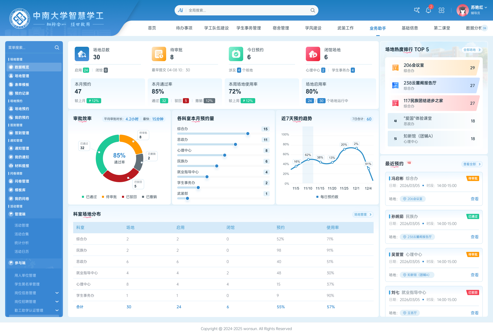

**页面内容包括：**
- 今日预约数、本月预约数、待审批数、场地总数
- 热门场地排行榜
- 各科室/部门预约量统计
- 近期预约趋势图

---

### 2.2 场地管理

#### 2.2.1 场地列表

点击左侧导航「场地管理」进入场地列表页面，展示所有已配置的场地。

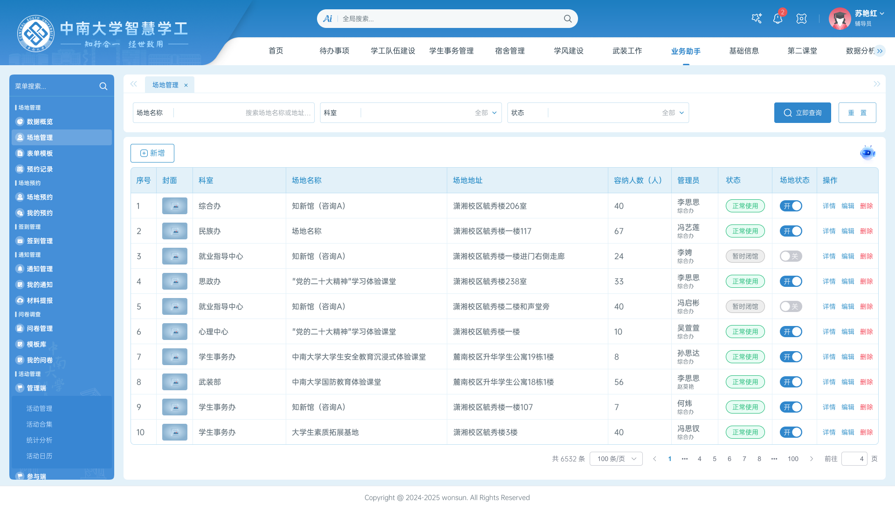

**操作说明：**
- 支持按科室筛选和搜索场地名称
- 每条记录显示场地名、所属科室、容纳人数、时段策略、状态
- 可点击「查看详情」进入详情页
- 可点击「编辑」进入编辑页面
- 可点击「新增场地」按钮创建新场地

#### 2.2.2 场地详情

点击列表中的场地名称或「详情」按钮，进入场地详情页。

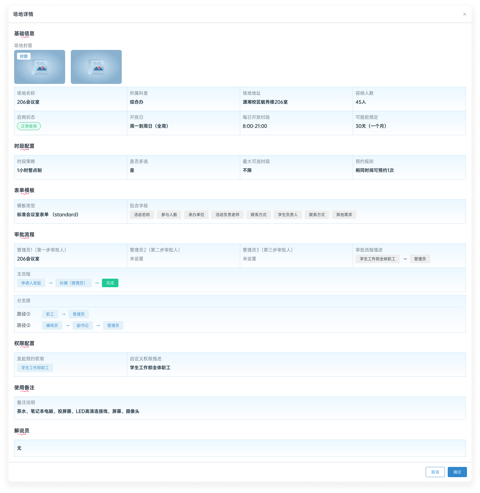

**展示信息：**
- 基础信息卡片（名称、地址、容纳人数、开放时间、状态等）
- 时段策略配置预览
- 表单模板预览
- 审批流程配置
- 预约须知内容（如已启用）
- 解说员/教练列表（如已配置）

#### 2.2.3 新增场地

点击「新增场地」按钮，进入场地创建向导，共分 5 个步骤：

**第一步：基础信息**

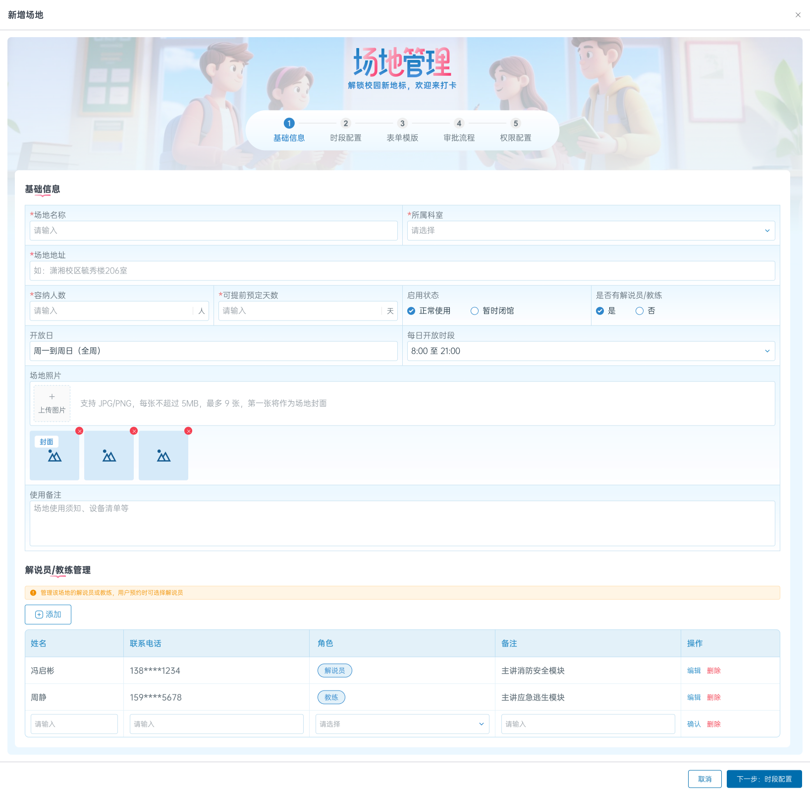

填写内容：
- 场地名称（必填）
- 所属科室（必填）
- 场地地址（必填）
- 容纳人数（必填）
- 可提前预定天数
- 启用状态（正常使用/暂时闭馆）
- 是否有解说员/教练（选"是"后展示解说员管理区）
- 开放日设置
- 每日开放时段
- 场地照片上传
- 使用备注
- 预约须知/用户协议（可选启用，启用后需填写须知内容）

**第二步：时段配置**

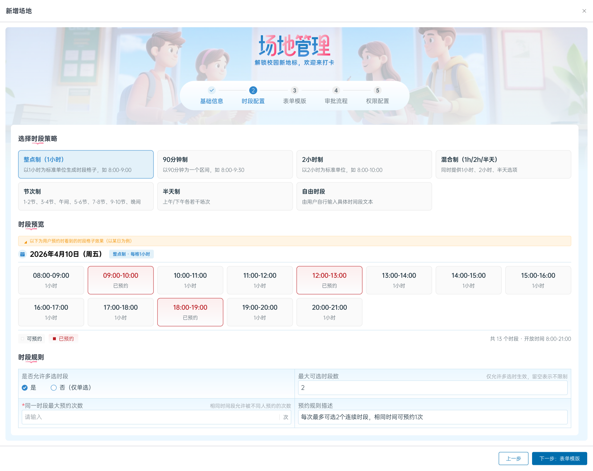

系统提供 7 种时段策略：

| 策略名称 | 说明 |
|---------|------|
| 整点制（1小时） | 以1小时为标准单位，如 8:00-9:00 |
| 90分钟制 | 以90分钟为一个区间，如 8:00-9:30 |
| 2小时制 | 以2小时为标准单位，如 8:00-10:00 |
| 混合制 | 同时提供1小时/2小时/半天选项 |
| 节次制 | 按教学节次划分，如1-2节、3-4节等 |
| 半天制 | 按上午/下午/晚间划分 |
| 自由时段 | 由用户自行输入时间段 |

选择策略后，页面将预览用户端看到的时段格子效果。同时需配置：
- 是否允许多选时段
- 最大可选时段数
- 同一时段最大预约次数

**第三步：表单模板**

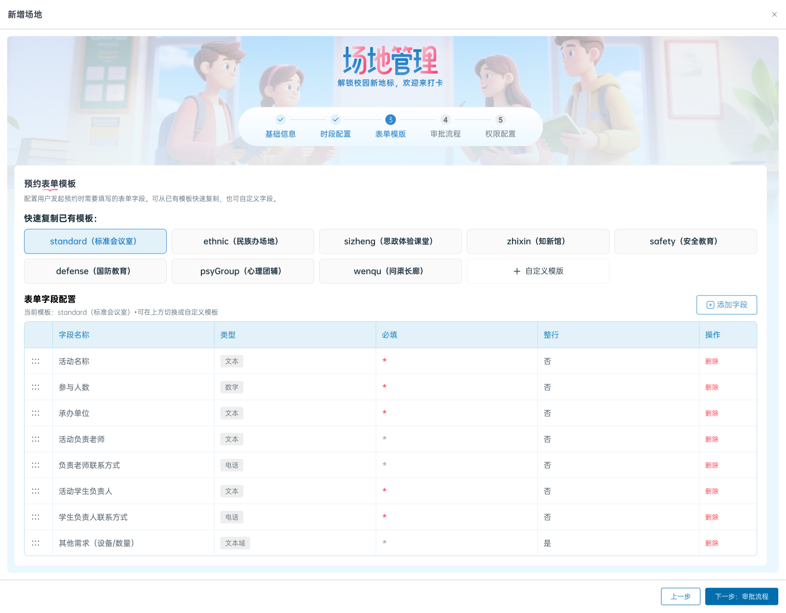

配置用户预约时需填写的信息字段：
- 可从预置模板（标准模板、知新馆模板、民族团结模板、团委活动模板等）快速复制
- 支持自定义添加字段，字段类型包括：文本、数字、电话、日期、单选、多选、文件上传、设备选择（复合字段）
- 可拖拽排序，设置是否必填

**第四步：审批流程**

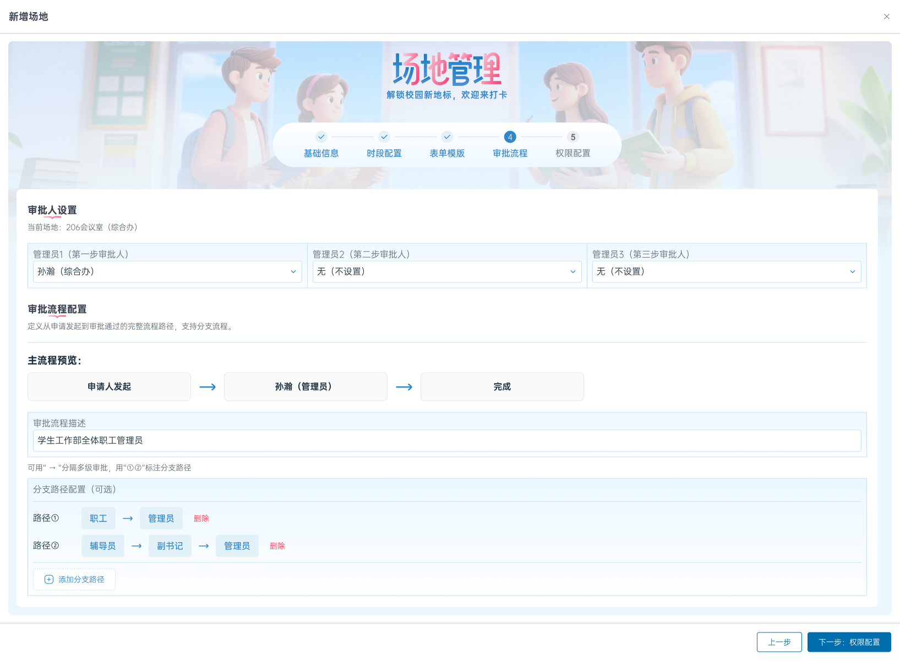

配置预约审批的流程节点：
- 设置审批人（管理员/指定人员）
- 配置审批路径分支（如按身份区分不同审批路径）
- 可配置条件审批节点（如预估人数≥500时增加校保卫处审批）
- 支持抄送设置

**第五步：权限配置**

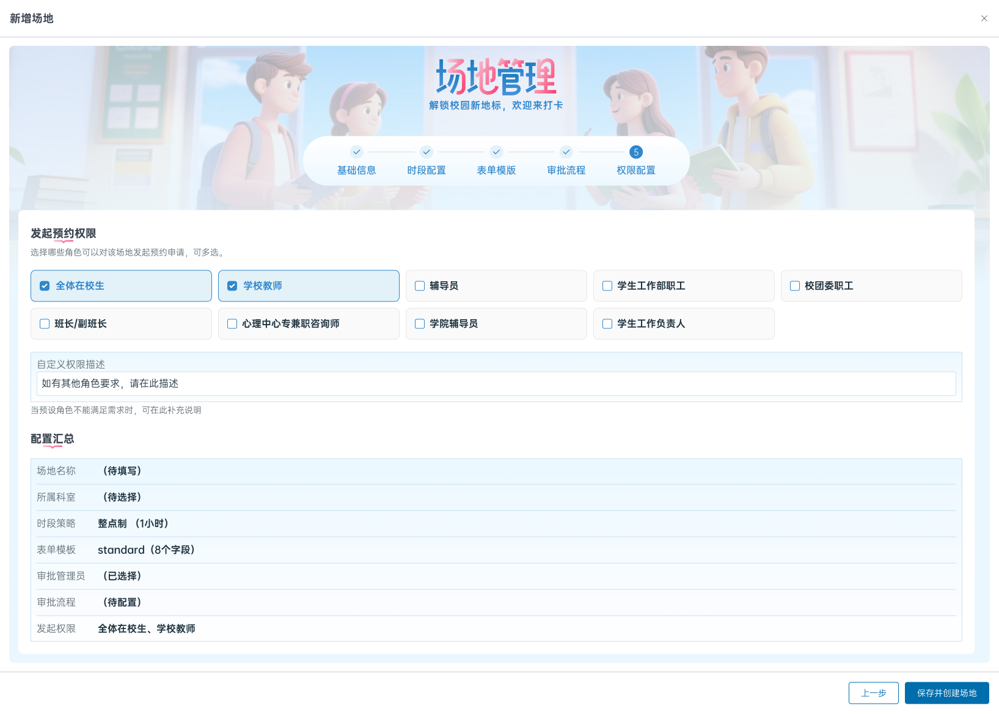

设置哪些人员可以预约该场地：
- 全校开放 / 指定科室 / 指定角色
- 预约限制规则

#### 2.2.4 编辑场地

在场地列表中点击「编辑」，进入与新增相同的向导界面，各步骤已预填现有数据，修改后保存即可。

#### 2.2.5 删除/停用场地

- **停用**：在列表中点击状态切换按钮，将场地设为"暂时闭馆"
- **删除**：点击「删除」按钮后弹出确认对话框，确认后永久删除

---

### 2.3 表单模板管理

#### 2.3.1 模板列表

点击左侧「表单模板」进入模板管理。

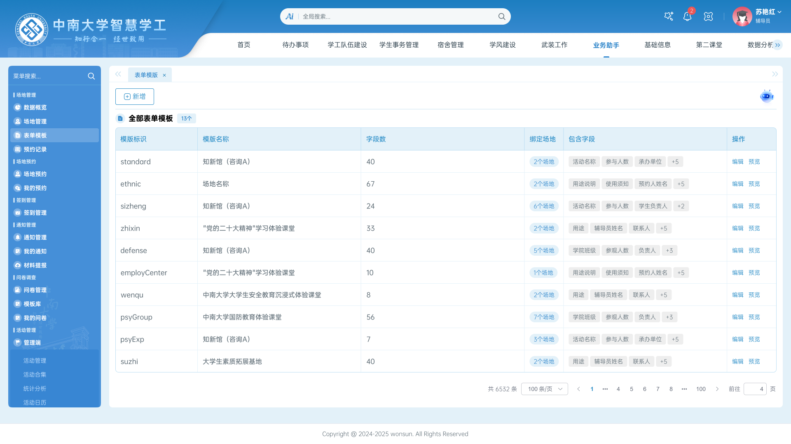

展示所有全局表单模板，包含模板名称、字段数量、适用场地数、创建时间等信息。

#### 2.3.2 新建/编辑模板

点击「新建模板」或列表中的「编辑」：
- 填写模板名称和描述
- 逐个添加字段（支持 9 种字段类型）
- 设置字段属性（名称、是否必填、占位提示文本等）
- 拖拽调整字段顺序

---

### 2.4 预约记录

点击左侧「预约管理」查看所有预约记录。

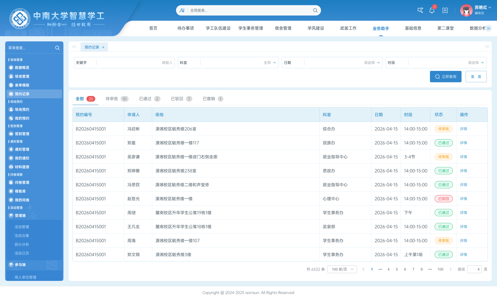

**功能：**
- 按状态筛选（全部/待审批/已通过/已驳回/已取消）
- 按日期范围筛选
- 搜索场地名/申请人
- 查看预约详情

---

## 三、预约端操作（PC 端）

### 3.1 浏览场地

登录系统后，进入「场地预约」页面，展示所有可预约的场地卡片。

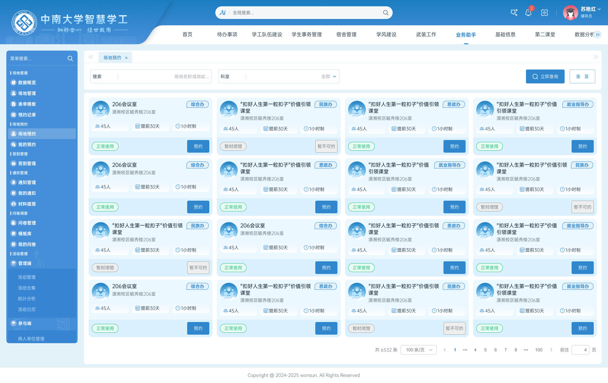

**操作说明：**
- 顶部可按部门/科室筛选
- 可搜索场地名称
- 每张卡片展示：场地照片、名称、科室、容纳人数、时段策略、状态
- 点击卡片进入场地详情

### 3.2 查看场地详情

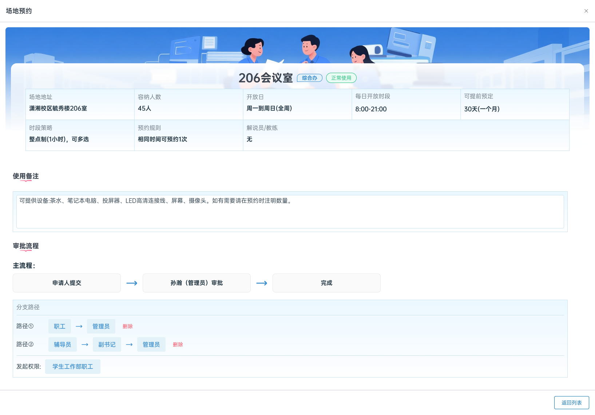

展示场地完整信息：
- 基本信息（地址、人数、开放时段等）
- 使用备注
- 审批流程说明
- 点击「立即预约」按钮开始预约流程

### 3.3 发起预约

预约流程分为 4 步：**选择场地 → 填写信息 → 选择时段 → 确认提交**

#### 3.3.1 第二步：填写信息

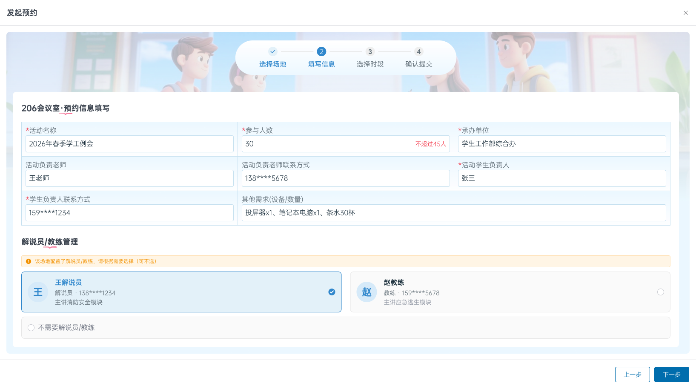

根据场地配置的表单模板填写预约信息，通常包含：
- 活动名称、参与人数、承办单位
- 负责老师及联系方式
- 学生负责人及联系方式
- 其他需求说明
- 解说员/教练选择（如场地已配置）

#### 3.3.2 第三步：选择时段

根据场地配置的时段策略，用户看到不同的时段选择界面：

**整点制（1小时）**

以网格形式展示各小时时段，已占用显示灰色，可点击选择。

**90分钟制**

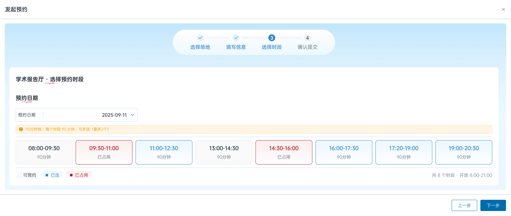

每个时段为90分钟，格子稍大，展示完整时间区间。

**2小时制**

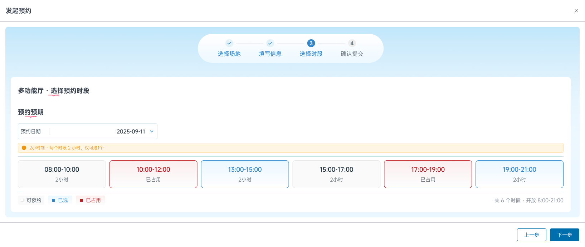

每个时段为2小时，3列布局，卡片更大更醒目。

**混合制（1h/2h/半天）**

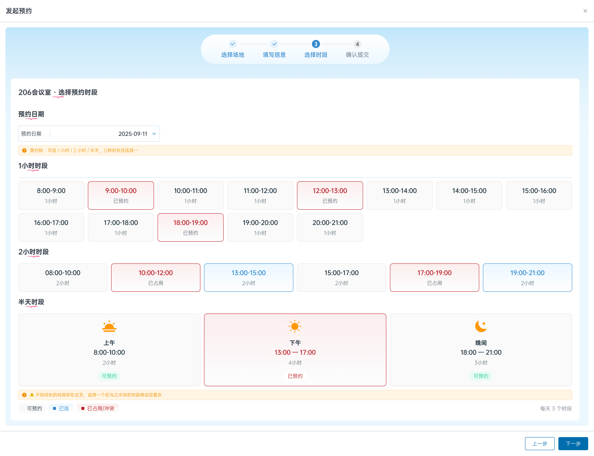

分三组展示：1小时时段、2小时时段、半天时段。用户选择其中一个，冲突时段自动置灰。

**节次制**

按教学节次展示（1-2节、3-4节...），双列卡片布局，展示节次名和具体时间。

**半天制**

三张大卡片（上午/下午/晚间），带图标和时长信息，一目了然。

**自由时段**

用户自行选择日期和起止时间，下方展示当日已有预约列表供参考，系统实时计算所选时长并检测冲突。

#### 3.3.3 第四步：确认提交

汇总展示所有已填信息，确认无误后提交。

#### 3.3.4 预约须知确认

如场地启用了预约须知，点击"确认提交"后将弹出须知弹窗：

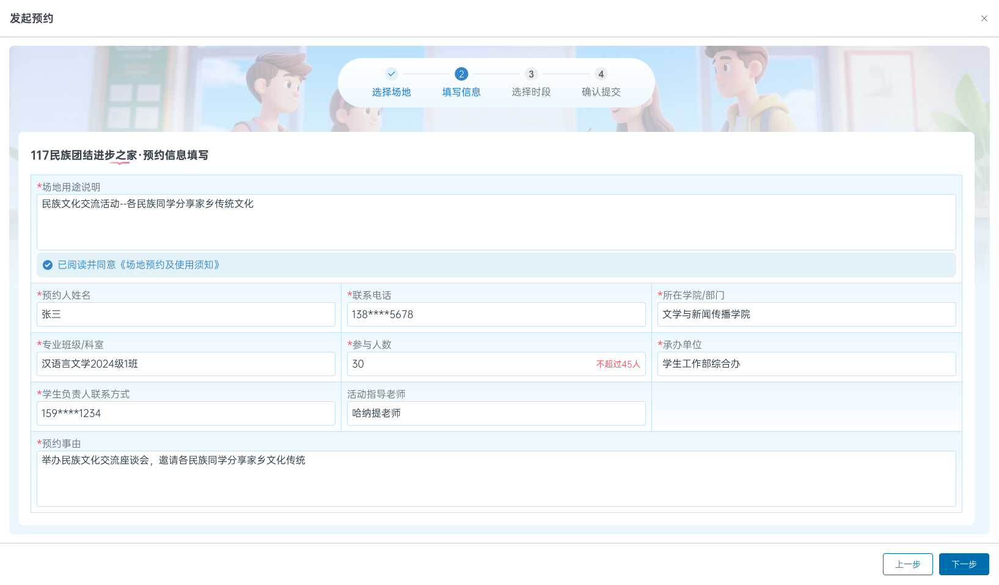

- 用户需阅读至底部后方可点击「我已阅读并同意」按钮
- 确认后正式提交预约

#### 3.3.5 预约成功

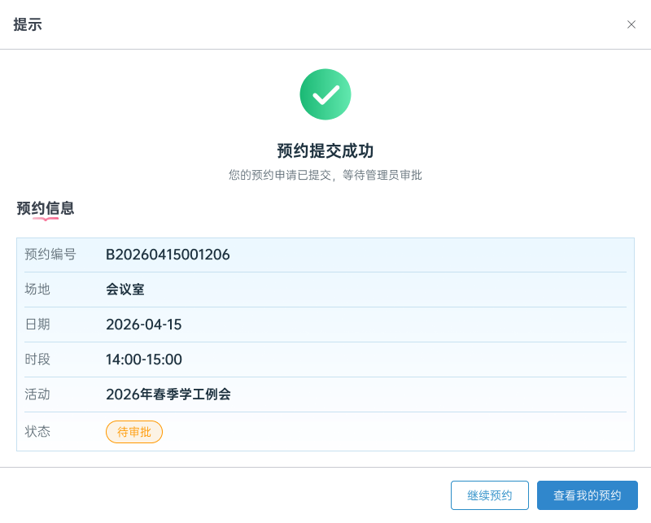

提交成功后展示成功页面，提示审批进度。

### 3.4 我的预约

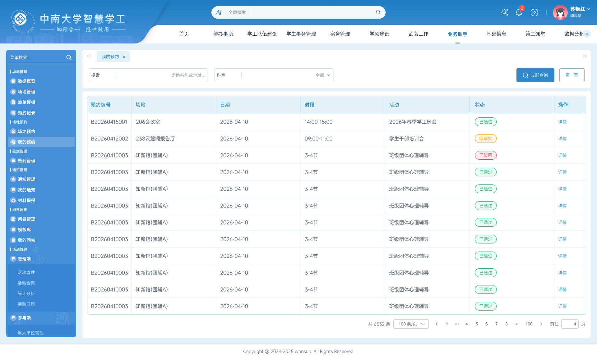

点击顶部「我的预约」查看历史预约记录：
- 按状态分类（待审批/已通过/已驳回）
- 可查看每条预约的详情
- 待审批的预约可取消

---

## 四、预约端操作（移动端）

移动端预约流程与 PC 端一致，适配手机屏幕展示。

### 4.1 场地列表

以卡片列表形式展示场地，支持横向标签筛选。

### 4.2 场地详情

展示场地信息，底部固定「立即预约」按钮。

### 4.3 填写表单

单列表单布局，适配移动端输入体验。

### 4.4 选择时段

移动端同样支持全部 7 种时段策略：

**整点制**

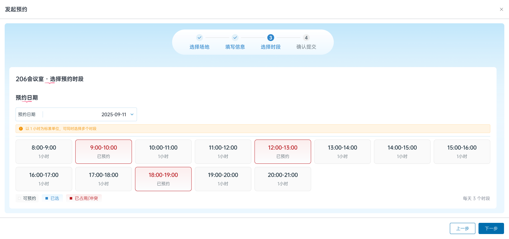

3列网格，紧凑布局。

**90分钟制**

2列布局，显示完整时间区间。

**2小时制**

2列大卡片，时间段清晰。

**混合制**

分组紧凑展示三种时长选项。

**节次制**

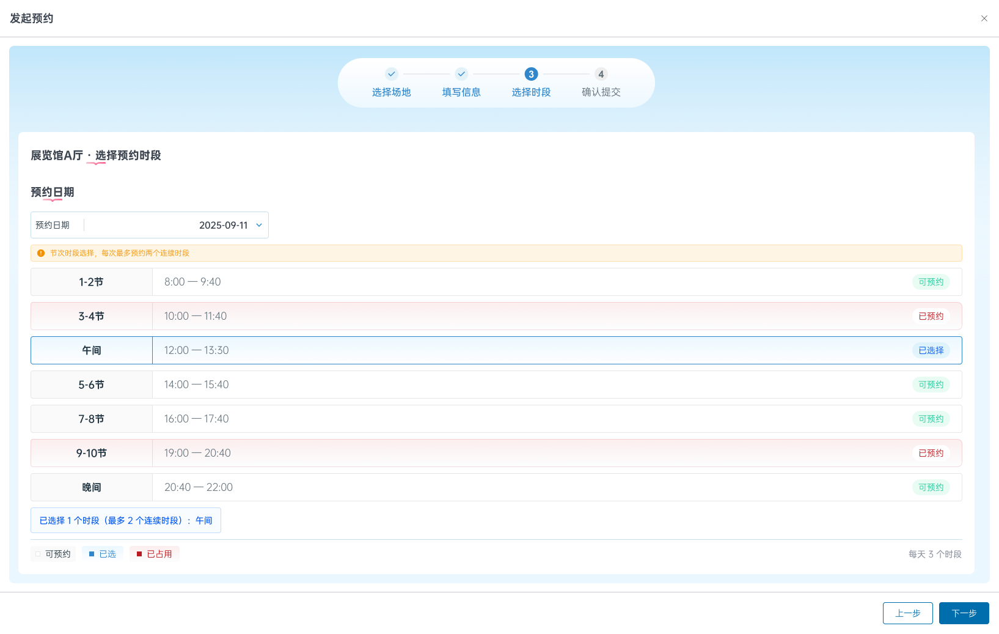

纵向列表卡片，每行展示节次名、时间、状态。

**半天制**

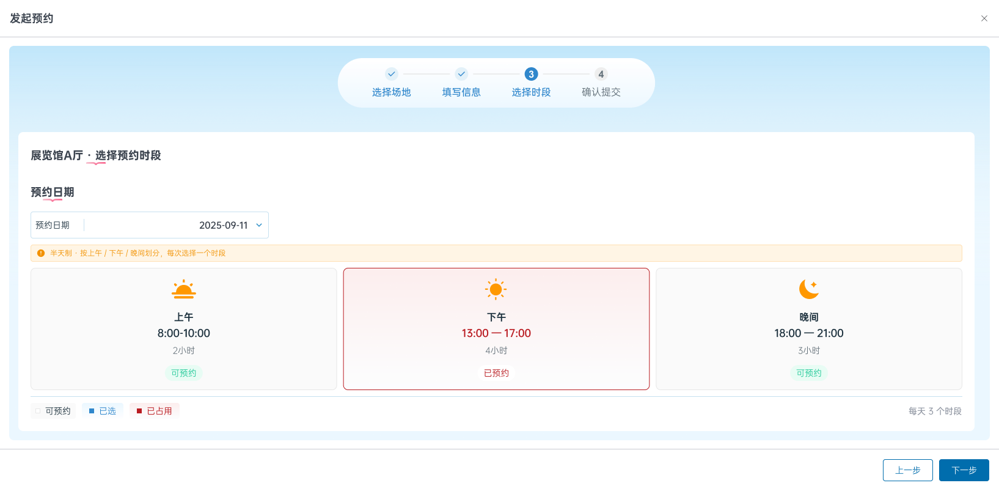

竖向大卡片，带图标直观展示。

**自由时段**

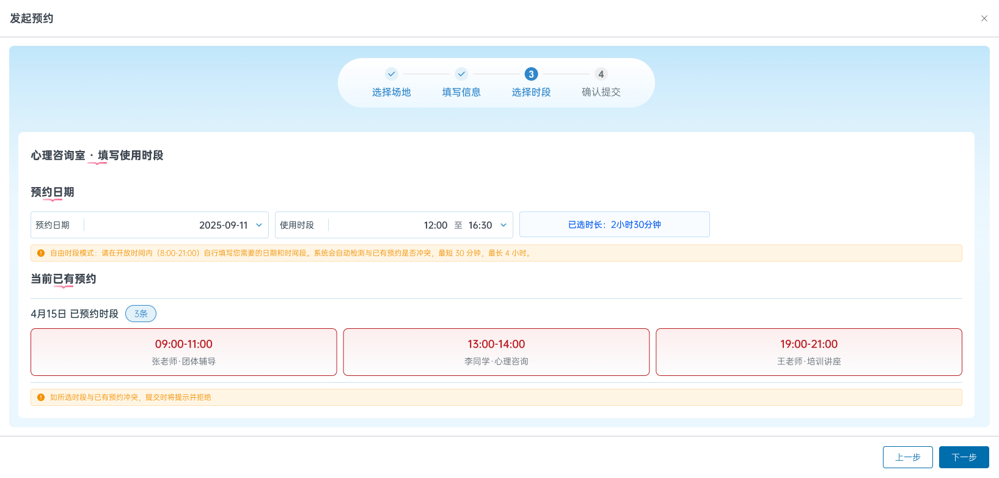

日期选择+起止时间下拉，下方展示当日已有预约。

### 4.5 确认提交

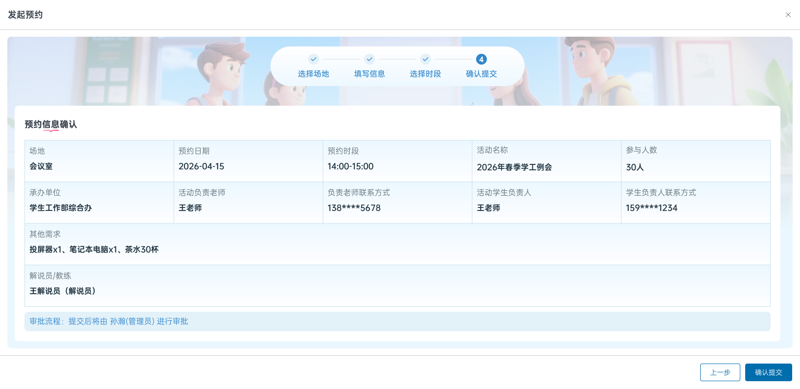

底部固定按钮，一键提交。

---

## 五、审批端操作（PC 端）

### 5.1 待办列表

审批人登录后看到待审批列表：
- 按状态分标签（待处理/已处理/全部）
- 展示流程名称、申请人、申请时间、状态
- 支持搜索和筛选

### 5.2 审批详情

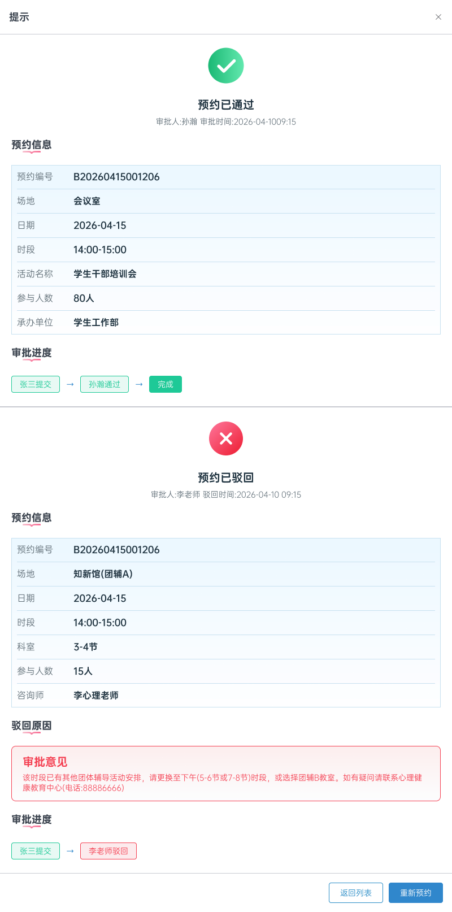

点击列表条目进入详情页：
- 顶部固定审批操作按钮（通过/驳回）
- 展示申请人提交的完整表单信息
- 审批流程进度
- 审批记录
- 抄送信息

### 5.3 操作审批

- 点击「通过」：弹出确认对话框，可填写审批意见，确认后通过
- 点击「驳回」：弹出确认对话框，需填写驳回原因，确认后驳回

---

## 六、审批端操作（移动端）

### 6.1 待办列表

移动端审批列表以卡片形式展示，底部标签栏切换"待处理/已处理"。

### 6.2 审批详情

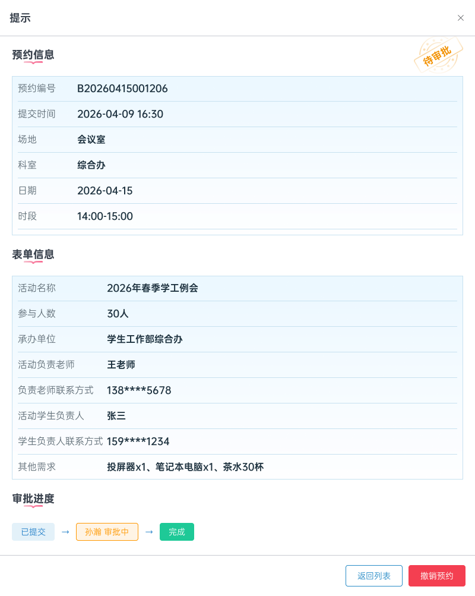

展示完整申请信息，底部固定审批操作按钮。

---

## 七、常见问题

### Q1：预约提交后多久能收到审批结果？
审批时效取决于审批人的处理速度，系统会通过消息通知提醒审批人及时处理。

### Q2：如何取消已提交的预约？
在「我的预约」中找到待审批状态的预约，点击进入详情后可取消。已通过的预约需联系管理员处理。

### Q3：时段显示"已占用"是什么意思？
表示该时段已被其他用户预约且审批通过，无法再选择。

### Q4：为什么提交时弹出了须知弹窗？
部分场地启用了预约须知，需阅读至底部并确认后方可提交，确保用户了解场地使用规范。

### Q5：混合制时段为什么选了一个其他的变灰了？
混合制不同时长的时段存在时间交叉，选择一个后与之冲突的时段会自动置灰，避免时间重叠。

---

*文档版本：V1.0*
*适用系统：智慧学工 · 场地预约系统*
*最后更新：2026年5月*
